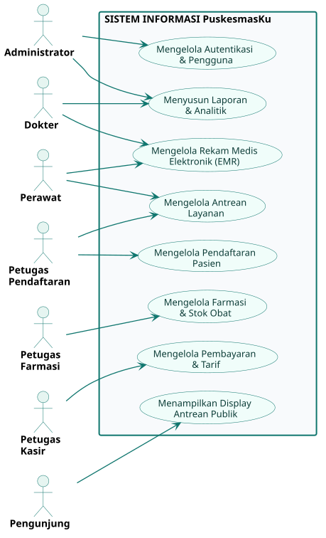
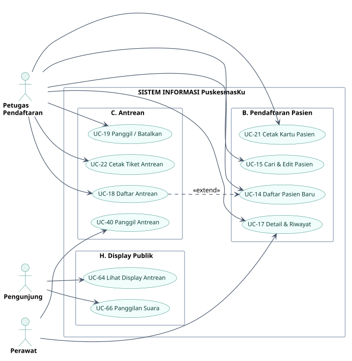
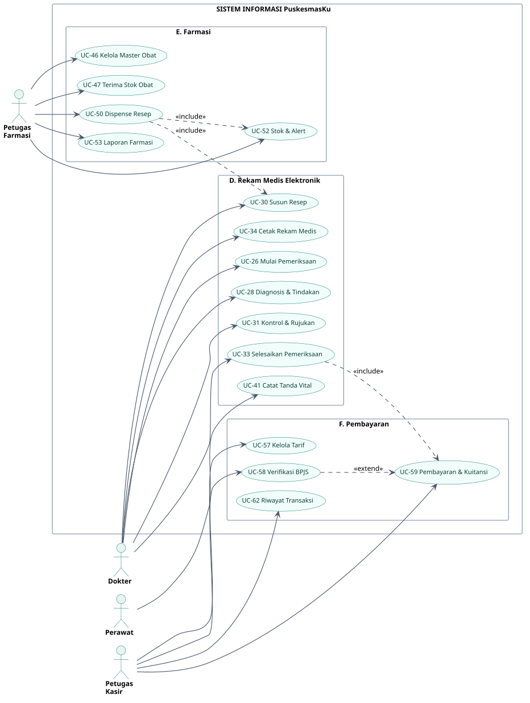
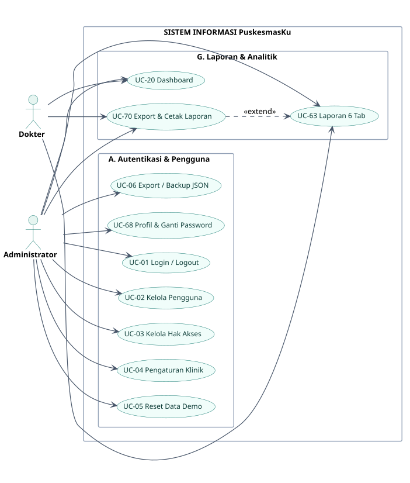
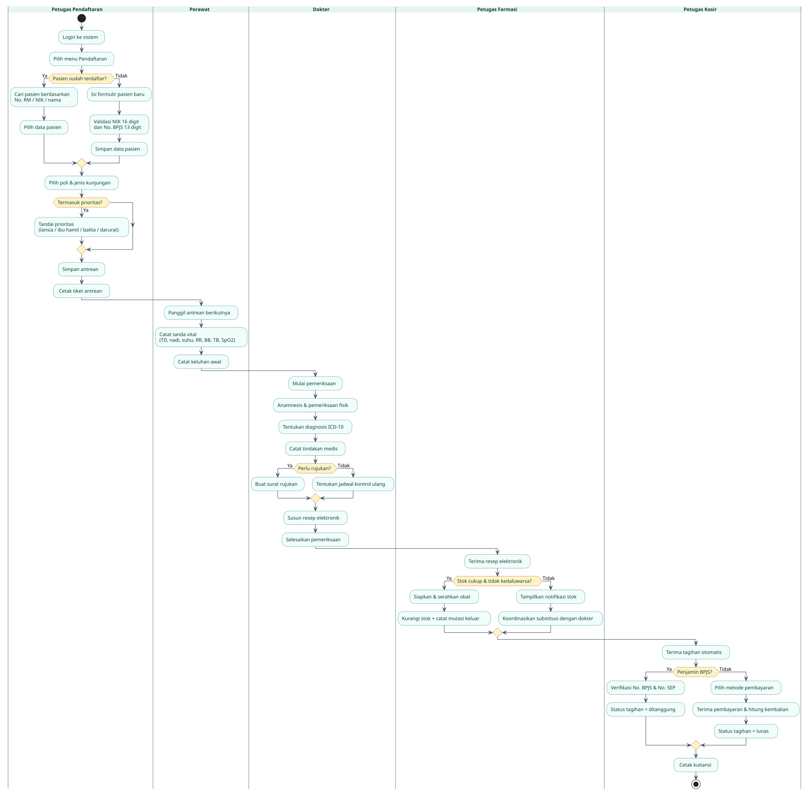
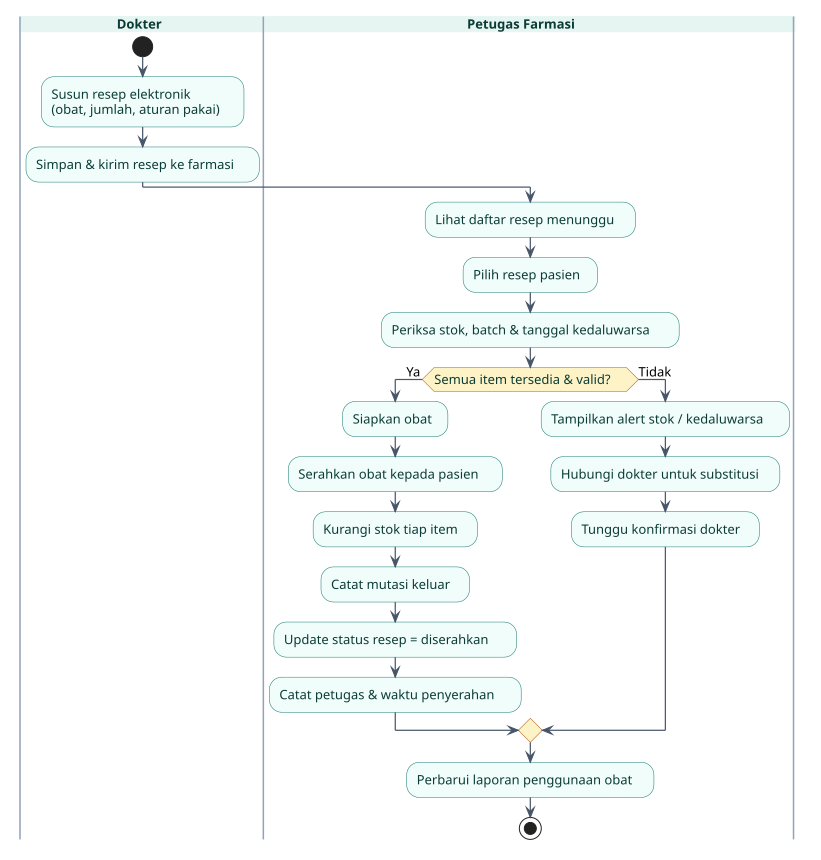
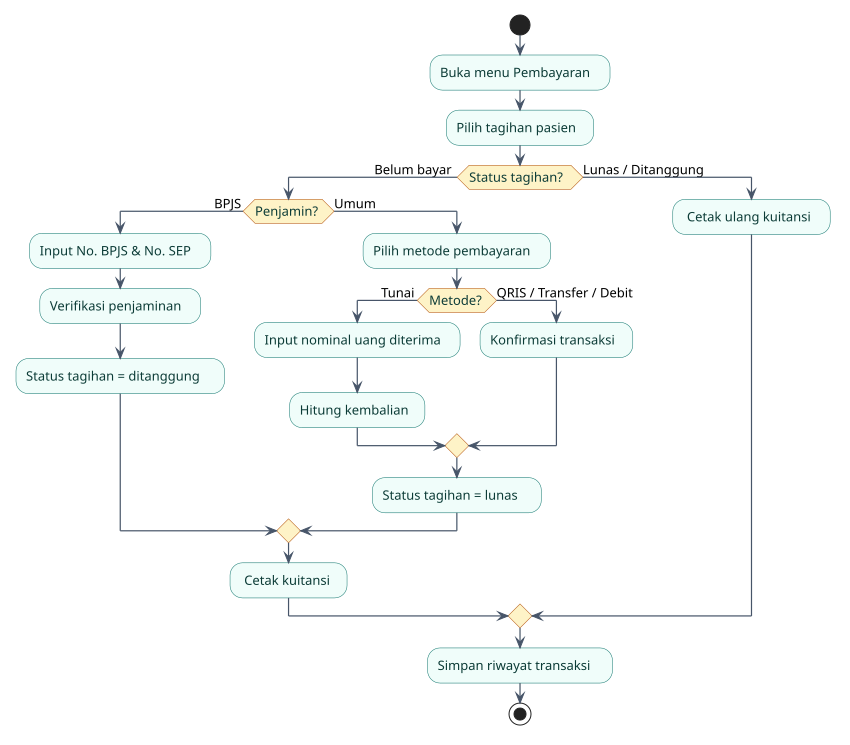
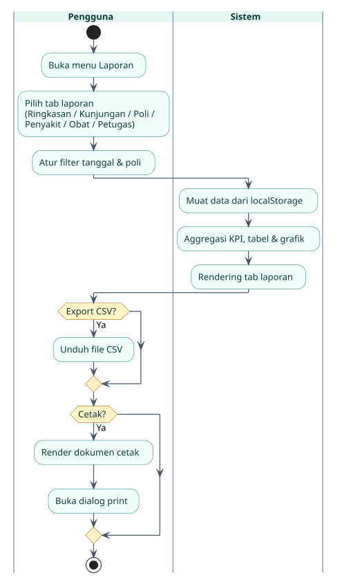
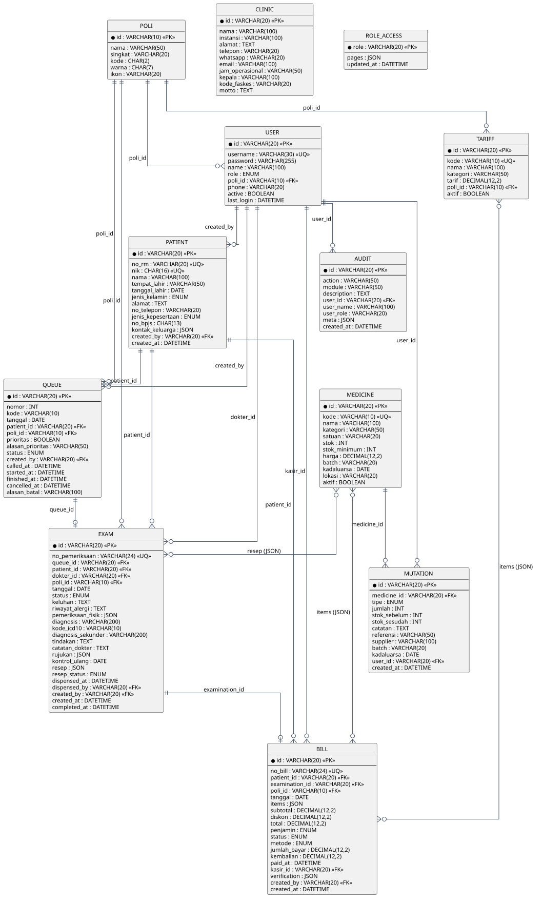
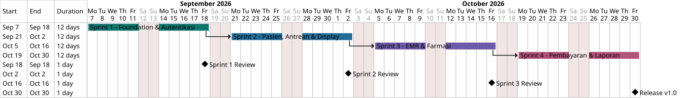

# MAKALAH SISTEM INFORMASI MANAJEMEN PUSKESMAS

## PuskesmasKu — Sistem Informasi Puskesmas Terpadu

---

### HALAMAN JUDUL

**MAKALAH PENGEMBANGAN SISTEM INFORMASI**
**PuskesmasKu — Sistem Informasi Manajemen Puskesmas Terpadu**

**Mata Kuliah**: Rekayasa Perangkat Lunak / Pengembangan Aplikasi Web  
**Program Studi**: Teknik Informatika / Ilmu Komputer  
**Semester**: 6  
**Tahun Akademik**: 2025/2026  

**Dosen Pembimbing**: Dr. [Nama Dosen], M.Kom.  
**Penyusun**: [Nama Mahasiswa] — NIM [NIM]  
**Tanggal**: 15 November 2026  

---

## ABSTRAK

PuskesmasKu adalah aplikasi web yang dirancang untuk mengelola seluruh operasional puskesmas, mulai dari pendaftaran pasien, antrean, rekam medis elektronik (EMR), farmasi, pembayaran, hingga laporan analitik. Sistem dibangun menggunakan arsitektur **Scrum** dengan 4 sprint, plain HTML/CSS/JavaScript (tanpa library eksternal), dan penyimpanan data lokal (localStorage). Terdapat 6 peran pengguna: Administrator, Petugas Pendaftaran, Dokter, Perawat, Petugas Farmasi, dan Petugas Kasir. Makalah ini merinci product backlog, use case diagram, activity diagram, ERD, dan perencanaan sprint 1–4.

**Kata Kunci**: Puskesmas, Sistem Informasi, Scrum, EMR, Antrean, Farmasi, Pembayaran

---

## DAFTAR ISI

1. Pendahuluan
2. Tinjauan Pustaka
3. Product Backlog
4. Use Case Diagram
5. Activity Diagram
6. Entity Relationship Diagram (ERD)
7. Perencanaan Sprint 1–4
8. Kesimpulan
9. Daftar Pustaka

---

## 1. PENDAHULUAN

### 1.1 Latar Belakang

Puskesmas sebagai fasilitas kesehatan tingkat pertama membutuhkan sistem informasi terpadu untuk:
- Meningkatkan efisiensi pendaftaran dan antrean pasien
- Mengelola rekam medis elektronik (EMR) secara digital
- Mengontrol stok obat dan farmasi
- Memfasilitasi pembayaran dan verifikasi BPJS
- Menghasilkan laporan analitik untuk evaluasi kinerja

Sistem manual yang digunakan saat ini rentan terhadap kesalahan pencatatan, kehilangan data, dan kesulitan pelaporan. Oleh karena itu, diperlukan aplikasi web yang terintegrasi.

### 1.2 Rumusan Masalah

1. Bagaimana merancang sistem informasi puskesmas yang mencakup seluruh modul operasional?
2. Bagaimana mengelola hak akses berdasarkan peran pengguna?
3. Bagaimana merancang database yang efisien untuk data klinis dan administratif?
4. Bagaimana menerapkan metodologi Scrum untuk pengembangan iteratif?

### 1.3 Tujuan

1. Membangun aplikasi web terpadu untuk manajemen puskesmas
2. Menerapkan role-based access control untuk 6 peran pengguna
3. Merancang database relasional dengan ERD yang jelas
4. Mengimplementasikan Scrum dengan 4 sprint

### 1.4 Ruang Lingkup

- **Modul**: Dashboard, Pendaftaran Pasien, Antrean, EMR, Farmasi, Pembayaran, Laporan, Pengguna & Hak Akses, Pengaturan, Display Publik
- **Peran**: Administrator, Petugas Pendaftaran, Dokter, Perawat, Petugas Farmasi, Petugas Kasir
- **Teknologi**: Plain HTML/CSS/JS, localStorage, hash-based routing
- **Metodologi**: Scrum (4 sprint)

---

## 2. TINJAUAN PUSTAKA

### 2.1 Sistem Informasi Manajemen

Sistem informasi manajemen (SIM) adalah sistem yang menyediakan informasi yang dibutuhkan untuk pengambilan keputusan manajerial. Dalam konteks puskesmas, SIM mencakup:
- **SIM Puskesmas**: Pengelolaan data pasien, kunjungan, dan layanan
- **EMR (Electronic Medical Record)**: Rekam medis digital
- **SIMRS**: Sistem informasi manajemen rumah sakit (skala lebih besar)

### 2.2 Metodologi Scrum

Scrum adalah framework Agile untuk pengembangan perangkat lunak yang iteratif dan inkremental. Komponen utama:
- **Product Backlog**: Daftar prioritas fitur yang harus dikembangkan
- **Sprint**: Iterasi pengembangan (biasanya 1–4 minggu)
- **Sprint Backlog**: Fitur yang dipilih untuk sprint tertentu
- **Daily Scrum**: Stand-up meeting harian
- **Sprint Review**: Review hasil sprint
- **Sprint Retrospective**: Evaluasi proses sprint

### 2.3 Role-Based Access Control (RBAC)

RBAC adalah model kontrol akses di mana izin diberikan berdasarkan peran pengguna. Dalam PuskesmasKu:
- Setiap peran memiliki akses ke modul tertentu (page access)
- Setiap peran memiliki kapabilitas tindakan (capability)
- Administrator memiliki akses penuh dan tidak dapat dibatasi

### 2.4 Entity Relationship Diagram (ERD)

ERD adalah model konseptual yang menggambarkan hubungan antar entitas dalam database. Komponen:
- **Entitas**: Objek yang memiliki atribut (Patient, Queue, Exam, dll.)
- **Atribut**: Properti entitas (nama, tanggal lahir, dll.)
- **Relasi**: Hubungan antar entitas (One-to-Many, Many-to-Many)
- **Cardinality**: Jumlah instance yang dapat berpartisipasi dalam relasi

---

## 3. PRODUCT BACKLOG

Product backlog adalah daftar prioritas fitur yang harus dikembangkan dalam PuskesmasKu. Backlog disusun berdasarkan prioritas bisnis dan kompleksitas teknis, lalu diestimasi menggunakan **story points** (skala Fibonacci: 1, 2, 3, 5, 8) dan dipetakan ke sprint.

**Visi Produk:** *"Menjadi satu-satunya sistem kerja harian puskesmas yang menghubungkan pendaftaran, pelayanan klinis, farmasi, pembayaran, dan pelaporan dalam satu alur data yang bebas duplikasi."*

**Product Goal (versi 1.0):** Seluruh petugas dapat menyelesaikan satu siklus pelayanan pasien — dari pendaftaran hingga kuitansi — tanpa pencatatan kertas, dengan hak akses yang sesuai peran dan laporan yang dapat diunduh.

### 3.1 Backlog Item Priority

Prioritas menggunakan kerangka **MoSCoW**:

| Prioritas | Deskripsi | Jumlah Item | Story Points |
|-----------|-----------|-------------|--------------|
| **Must Have** | Fitur kritis; sistem tidak layak dirilis tanpa fitur ini | 49 | 186 |
| **Should Have** | Fitur penting; dapat ditunda satu sprint jika terpaksa | 27 | 87 |
| **Could Have** | Fitur tambahan yang meningkatkan kenyamanan | 6 | 17 |
| **Won't Have (v1.0)** | Ditetapkan di luar ruang lingkup rilis pertama | 0 | 0 |
| **Total** | | **82** | **290** |

> **Catatan:** item *Won't Have* untuk v1.0 — integrasi API BPJS real-time, modul laboratorium, rawat inap, dan aplikasi mobile pasien — dicatat sebagai **future backlog** dan tidak dihitung dalam 82 item di atas.

### 3.2 Product Backlog (Daftar Lengkap)

#### Modul A: Autentikasi & Pengguna (10 item)

| ID | Backlog Item | Prioritas | Story Points |
|----|--------------|-----------|--------------|
| PB-001 | Login dengan username & password | Must Have | 3 |
| PB-002 | Logout dengan audit trail | Must Have | 2 |
| PB-003 | Password reset mandiri via nomor telepon | Should Have | 5 |
| PB-004 | Change password mandiri (current → new → confirm) | Should Have | 3 |
| PB-005 | Update profil pengguna (nama, telepon) | Should Have | 2 |
| PB-006 | Admin: Create user baru | Must Have | 5 |
| PB-007 | Admin: Update data user | Must Have | 3 |
| PB-008 | Admin: Toggle aktif/nonaktif user | Must Have | 3 |
| PB-009 | Admin: Reset password user | Must Have | 2 |
| PB-010 | Admin: Matriks hak akses per role (editable) | Must Have | 8 |

#### Modul B: Pendaftaran Pasien (8 item)

| ID | Backlog Item | Prioritas | Story Points |
|----|--------------|-----------|--------------|
| PB-011 | Daftar pasien baru dengan validasi NIK/BPJS | Must Have | 5 |
| PB-012 | Cari pasien berdasarkan RM, NIK, nama | Must Have | 3 |
| PB-013 | Edit data pasien | Must Have | 3 |
| PB-014 | Detail pasien dengan riwayat kunjungan | Must Have | 5 |
| PB-015 | Cetak kartu pasien dengan barcode | Should Have | 5 |
| PB-016 | Validasi NIK 16 digit unik | Must Have | 2 |
| PB-017 | Validasi BPJS 13 digit (jika BPJS) | Must Have | 2 |
| PB-018 | Export data pasien ke CSV | Could Have | 2 |

#### Modul C: Antrean Pasien (10 item)

| ID | Backlog Item | Prioritas | Story Points |
|----|--------------|-----------|--------------|
| PB-019 | Daftar antrean baru per poli | Must Have | 5 |
| PB-020 | Priority queue (lansia, ibu hamil, disabilitas, balita, darurat) | Must Have | 5 |
| PB-021 | Panggil antrean berikutnya | Must Have | 3 |
| PB-022 | Status antrean: Menunggu → Dipanggil → Dilayani → Selesai → Batal | Must Have | 3 |
| PB-023 | Estimasi waktu tunggu berdasarkan antrean | Should Have | 3 |
| PB-024 | Batal antrean dengan alasan | Should Have | 2 |
| PB-025 | Cetak tiket antrean | Should Have | 3 |
| PB-026 | Filter & pencarian antrean (poli, status, tanggal) | Could Have | 2 |
| PB-027 | Penyesuaian urutan antrean prioritas | Should Have | 3 |
| PB-028 | Riwayat antrean harian per poli | Could Have | 3 |

#### Modul D: Rekam Medis Elektronik (12 item)

| ID | Backlog Item | Prioritas | Story Points |
|----|--------------|-----------|--------------|
| PB-029 | Mulai pemeriksaan dari antrean | Must Have | 3 |
| PB-030 | Catat tanda vital (TD, nadi, suhu, respirasi, BB, TB, SpO2) | Must Have | 5 |
| PB-031 | Input keluhan pasien | Must Have | 2 |
| PB-032 | Diagnosis ICD-10 (12 diagnosis umum + 2 gigi) | Must Have | 5 |
| PB-033 | Catat tindakan fisik | Should Have | 2 |
| PB-034 | Susun resep elektronik (obat, jumlah, aturan) | Must Have | 5 |
| PB-035 | Kontrol ulang (14 hari untuk hipertensi/diabetes) | Should Have | 2 |
| PB-036 | Rujukan ke fasilitas lain | Should Have | 3 |
| PB-037 | Selesaikan pemeriksaan + buat tagihan otomatis | Must Have | 5 |
| PB-038 | Cetak rekam medis lengkap dengan resep | Should Have | 5 |
| PB-039 | Edit draf pemeriksaan sebelum selesai | Must Have | 3 |
| PB-040 | Pemeriksaan yang selesai tidak dapat diubah | Must Have | 2 |

#### Modul E: Farmasi & Obat (12 item)

| ID | Backlog Item | Prioritas | Story Points |
|----|--------------|-----------|--------------|
| PB-041 | Master obat: nama, kategori, satuan, harga, stok, minimum, kadaluwarsa | Must Have | 5 |
| PB-042 | Penerimaan stok obat dari distributor | Must Have | 5 |
| PB-043 | Pengeluaran obat berdasarkan resep | Must Have | 3 |
| PB-044 | Alert stok menipis (stok ≤ minimum) | Must Have | 2 |
| PB-045 | Alert stok habis (stok = 0) | Must Have | 2 |
| PB-046 | Alert obat kedaluwarsa | Must Have | 2 |
| PB-047 | Alert obat akan kedaluwarsa (60 hari) | Should Have | 2 |
| PB-048 | Resep menunggu diserahkan ke farmasi | Must Have | 3 |
| PB-049 | Riwayat mutasi stok lengkap | Should Have | 3 |
| PB-050 | Dispense resep: kurangi stok, buat mutasi | Must Have | 5 |
| PB-051 | Laporan penggunaan obat per periode | Should Have | 5 |
| PB-052 | Cetak laporan farmasi | Could Have | 3 |

#### Modul F: Pembayaran & Tarif (10 item)

| ID | Backlog Item | Prioritas | Story Points |
|----|--------------|-----------|--------------|
| PB-053 | Kelola tarif layanan (konsultasi, tindakan, administrasi) | Must Have | 5 |
| PB-054 | Verifikasi penjaminan BPJS (cek nomor kartu SEP) | Must Have | 5 |
| PB-055 | Terima pembayaran: Tunai, QRIS, Transfer, Kartu Debit | Must Have | 5 |
| PB-056 | Cetak kuitansi/resep digital | Must Have | 5 |
| PB-057 | Tagihan manual untuk pasien tanpa pemeriksaan | Should Have | 3 |
| PB-058 | Riwayat transaksi lengkap per pasien | Must Have | 3 |
| PB-059 | Filter tagihan: Belum, Lunas, Ditanggung BPJS | Should Have | 2 |
| PB-060 | Export riwayat transaksi ke CSV | Could Have | 2 |
| PB-061 | Verifikasi BPJS: belum → diverifikasi | Must Have | 3 |
| PB-062 | Set status tagihan: Belum → Dibayar → Ditanggung | Must Have | 3 |

#### Modul G: Laporan & Analitik (10 item)

| ID | Backlog Item | Prioritas | Story Points |
|----|--------------|-----------|--------------|
| PB-063 | 6 tab laporan: Ringkasan, Kunjungan, Poli, Penyakit, Obat, Petugas | Must Have | 8 |
| PB-064 | Filter per tanggal (range picker), poli, status | Must Have | 5 |
| PB-065 | Ringkasan KPI: kunjungan, pendapatan, resep, stok | Must Have | 3 |
| PB-066 | Laporan kunjungan per poli dengan grafik | Should Have | 5 |
| PB-067 | Laporan penyakit & diagnosis ICD-10 | Should Have | 5 |
| PB-068 | Laporan obat terpakai dan stok | Should Have | 5 |
| PB-069 | Laporan kinerja petugas (audit log) | Should Have | 5 |
| PB-070 | Export laporan ke CSV | Must Have | 3 |
| PB-071 | Cetak laporan terformat | Should Have | 5 |
| PB-072 | Filter data historis: 30 hari + hari ini | Must Have | 2 |

#### Modul H: Display Publik & Pengaturan (10 item)

| ID | Backlog Item | Prioritas | Story Points |
|----|--------------|-----------|--------------|
| PB-073 | Layar antrean tanpa autentikasi | Must Have | 8 |
| PB-074 | Menampilkan nomor antrean yang dipanggil | Must Have | 3 |
| PB-075 | Menampilkan antrean berikutnya per poli | Must Have | 3 |
| PB-076 | Menampilkan motto puskesmas | Should Have | 1 |
| PB-077 | Tombol fullscreen & kembali | Should Have | 2 |
| PB-078 | Speech announcement panggilan | Could Have | 5 |
| PB-079 | Pengaturan klinik (nama, instansi, alamat, kontak, motto) | Must Have | 3 |
| PB-080 | Reset data demonstrasi | Should Have | 3 |
| PB-081 | Export cadangan data JSON | Should Have | 2 |
| PB-082 | Bump seed version jika schema berubah | Should Have | 1 |

### 3.3 Ringkasan Backlog

| Modul | Jumlah Item | Total Story Points |
|-------|-------------|--------------------|
| A. Autentikasi & Pengguna | 10 | 36 |
| B. Pendaftaran Pasien | 8 | 27 |
| C. Antrean Pasien | 10 | 32 |
| D. Rekam Medis Elektronik | 12 | 42 |
| E. Farmasi & Obat | 12 | 40 |
| F. Pembayaran & Tarif | 10 | 36 |
| G. Laporan & Analitik | 10 | 46 |
| H. Display Publik & Pengaturan | 10 | 31 |
| **Total** | **82** | **290** |

### 3.4 User Story & Acceptance Criteria

Setiap backlog item diturunkan menjadi *user story* dengan format **"Sebagai … saya ingin … sehingga …"** dan dilengkapi *acceptance criteria* yang dapat diuji. Berikut delapan user story representatif yang mencakup alur kritis sistem.

#### US-01 — Autentikasi dan Sesi (PB-001, PB-002)

> **Sebagai** pengguna terdaftar, **saya ingin** masuk menggunakan username dan password, **sehingga** saya dapat mengakses modul sesuai peran saya.

**Acceptance Criteria:**
1. Login dengan kredensial valid mengarahkan pengguna ke `#/dashboard` dan menampilkan nama serta peran di topbar.
2. Login dengan kredensial salah menampilkan pesan "Username atau password salah" tanpa membuat sesi.
3. Akun dengan `active = false` ditolak dengan pesan "Akun dinonaktifkan. Hubungi administrator."
4. Sesi disimpan di `localStorage` (`PuskesmasKu.session.v1`) dan tetap aktif setelah halaman dimuat ulang.
5. Logout menghapus sesi, mengembalikan pengguna ke `#/login`, dan mencatat aksi `auth.logout` pada audit trail.
6. Percobaan login yang gagal tidak mengubah data pengguna dan tidak membocorkan apakah username terdaftar.

#### US-02 — Matriks Hak Akses (PB-010)

> **Sebagai** administrator, **saya ingin** mengatur halaman yang dapat diakses setiap peran, **sehingga** pembatasan akses dapat menyesuaikan struktur organisasi tanpa mengubah kode.

**Acceptance Criteria:**
1. Matriks menampilkan 6 peran × seluruh halaman aplikasi dalam bentuk checkbox.
2. Perubahan disimpan ke `ROLE_ACCESS.pages` dan langsung memperbarui menu sidebar pengguna dengan peran tersebut.
3. Administrator tidak dapat menghapus aksesnya sendiri ke halaman `#/pengguna` (menu terkunci).
4. Tombol **Reset ke Default** mengembalikan matriks ke konfigurasi awal setelah konfirmasi.
5. Akses langsung melalui URL ke halaman yang tidak diizinkan menampilkan halaman **Akses Ditolak**, bukan konten halaman.
6. Setiap penyimpanan mencatat audit `access.update` berisi peran, daftar halaman, dan nama admin.

#### US-03 — Pendaftaran Pasien Baru (PB-011, PB-016, PB-017)

> **Sebagai** petugas pendaftaran, **saya ingin** mendaftarkan pasien baru dengan validasi identitas, **sehingga** tidak terjadi duplikasi rekam medis.

**Acceptance Criteria:**
1. NIK wajib 16 digit angka dan unik; NIK duplikat ditolak dengan pesan yang menyebutkan No. RM yang sudah ada.
2. No. BPJS wajib 13 digit apabila jenis kepesertaan = BPJS; apabila Umum, field dapat dikosongkan.
3. Nomor rekam medis dibuat otomatis dengan format `RM-YYYY-XXXX` dan tidak pernah berubah.
4. Nomor telepon dinormalisasi ke format `08xxxxxxxxxx`; input tidak valid ditolak.
5. Data tersimpan muncul pada pencarian berdasarkan nama, NIK, atau No. RM tanpa reload halaman.
6. Aksi `patient.create` tercatat pada audit trail beserta ID petugas.
7. Kartu pasien dapat dicetak dan memuat nama, No. RM, NIK, jenis kepesertaan, serta identitas puskesmas.

#### US-04 — Antrean Prioritas dan Display Publik (PB-020, PB-024, PB-073, PB-078)

> **Sebagai** petugas pendaftaran, **saya ingin** menandai pasien prioritas dan memanggil antrean, **sehingga** pasien lansia, ibu hamil, balita, disabilitas, dan darurat dapat dilayani lebih dahulu.

**Acceptance Criteria:**
1. Nomor antrean berurutan per poli per hari dan dimulai dari 1 pada hari baru (format `U-001`, `G-001`, dst.).
2. Alasan prioritas yang tersedia: Lansia, Ibu Hamil, Balita, Disabilitas, Darurat.
3. Antrean prioritas dipanggil sebelum antrean reguler pada poli yang sama; urutan di dalam kelompok mengikuti waktu pendaftaran.
4. Status antrean hanya dapat berpindah melalui alur: `menunggu → dipanggil → dilayani → selesai`, atau `menunggu/dipanggil → batal`.
5. Pembatalan wajib menyertakan alasan dan mencatat waktu serta petugas pembatal.
6. Display publik `#/display` dapat dibuka tanpa login, menampilkan panggilan terakhir dan minimal 5 antrean berikutnya per poli.
7. Display memperbarui data maksimal 2 detik setelah perubahan dan membersihkan interval/event listener saat pengguna meninggalkan halaman.
8. Panggilan suara hanya dipicu setelah interaksi pengguna (kebijakan autoplay browser) dan dapat dimatikan.

#### US-05 — Rekam Medis Elektronik dan Resep (PB-029, PB-032, PB-034, PB-037)

> **Sebagai** dokter, **saya ingin** mengisi diagnosis, tindakan, dan resep dalam satu layar, **sehingga** pemeriksaan selesai dan tagihan terbentuk otomatis.

**Acceptance Criteria:**
1. Pemeriksaan hanya dapat dimulai dari antrean berstatus `dipanggil` atau `dilayani`; status antrean berubah menjadi `dilayani`.
2. Tanda vital divalidasi pada rentang wajar (contoh: suhu 34–42 °C, SpO₂ 0–100%, tekanan darah sistolik 60–250 mmHg).
3. Diagnosis utama wajib dipilih dari daftar ICD-10 sebelum tombol **Selesaikan** aktif.
4. Setiap item resep wajib memiliki obat, jumlah > 0, dan aturan pakai; obat dengan stok 0 diberi penanda.
5. Menyelesaikan pemeriksaan menghasilkan tagihan otomatis berisi konsultasi, administrasi, dan obat; status antrean menjadi `selesai`.
6. Pemeriksaan berstatus `selesai` tidak dapat diedit (field dinonaktifkan) dan hanya dapat dicetak.
7. Cetak rekam medis memuat identitas pasien, tanda vital, diagnosis, tindakan, resep, dan tanda tangan dokter.

#### US-06 — Dispensing Resep di Farmasi (PB-048, PB-050)

> **Sebagai** petugas farmasi, **saya ingin** menyerahkan obat berdasarkan resep elektronik, **sehingga** stok berkurang dan riwayat mutasi tercatat secara otomatis.

**Acceptance Criteria:**
1. Daftar resep menunggu hanya menampilkan resep dengan status `menunggu`.
2. Sistem memeriksa ketersediaan stok dan tanggal kedaluwarsa seluruh item sebelum dispensing.
3. Apabila stok tidak cukup atau obat kedaluwarsa, proses dibatalkan dan tidak ada mutasi stok yang dibuat.
4. Dispensing berhasil mengurangi stok setiap item, membuat mutasi `keluar`, mengisi `dispensedAt`/`dispensedBy`, dan mengubah status resep menjadi `diserahkan`.
5. Alert stok mencakup empat kategori: menipis (`stok ≤ minimum`), habis (`stok = 0`), kedaluwarsa, dan akan kedaluwarsa (≤ 60 hari).
6. Penerimaan stok membuat mutasi `masuk` dan menambah stok sesuai jumlah diterima.

#### US-07 — Verifikasi BPJS dan Pembayaran (PB-054, PB-055, PB-056)

> **Sebagai** petugas kasir, **saya ingin** memverifikasi penjaminan dan menerima pembayaran, **sehingga** status tagihan dan kuitansi selalu akurat.

**Acceptance Criteria:**
1. Tagihan berstatus `belum` dapat diverifikasi BPJS dengan mengisi No. BPJS (13 digit) dan No. SEP.
2. Setelah verifikasi berhasil, status tagihan menjadi `ditanggung` dan nominal yang dibayar pasien menjadi Rp0.
3. Metode pembayaran yang tersedia: Tunai, QRIS, Transfer Bank, dan Kartu Debit.
4. Pembayaran tunai mewajibkan nominal ≥ total; kembalian dihitung otomatis. Metode non-tunai menggunakan nominal tepat.
5. Tagihan yang sudah `lunas` atau `ditanggung` tidak dapat dibayar ulang; sistem hanya menyediakan cetak ulang kuitansi.
6. Kuitansi memuat No. tagihan, identitas pasien, rincian item, total, metode, kasir, dan waktu pembayaran.
7. Riwayat transaksi dapat difilter dan diekspor ke CSV.

#### US-08 — Laporan dan Ekspor (PB-063, PB-070, PB-071)

> **Sebagai** pengguna, **saya ingin** melihat laporan enam tab dan mengekspornya, **sehingga** data dapat dianalisis dan dilampirkan pada rapat evaluasi.

**Acceptance Criteria:**
1. Tersedia enam tab: Ringkasan, Kunjungan, Poli, Penyakit, Obat, dan Petugas.
2. Filter tanggal (rentang), poli, dan status berlaku konsisten pada tabel, KPI, serta grafik.
3. KPI hanya menghitung pemeriksaan berstatus `selesai`; data 30 hari terakhir menjadi nilai default.
4. Kondisi tanpa data menampilkan *empty state*, bukan tabel kosong atau error.
5. Ekspor CSV menggunakan data yang sudah difilter dan menyertakan BOM UTF-8 agar terbaca benar di Excel.
6. Cetak laporan menyertakan kop puskesmas, periode, tabel, dan kolom tanda tangan.
7. Deep link `#/laporan/poli` membuka tab Poli secara langsung.

### 3.5 Definition of Ready dan Definition of Done

**Definition of Ready (DoR)** — syarat sebuah backlog item boleh masuk sprint:

- [ ] Memiliki aktor, tujuan, dan nilai bisnis yang jelas.
- [ ] Acceptance criteria ditulis dan disepakati Product Owner.
- [ ] Story point sudah diestimasi melalui *planning poker*.
- [ ] Dependensi antarmodul dan data seed sudah diidentifikasi.
- [ ] Desain UI/kebutuhan cetak (jika ada) sudah dipahami tim.
- [ ] Skenario pengujian utama dan data uji tersedia.

**Definition of Done (DoD)** — syarat sebuah item dianggap selesai:

- [ ] Kode berjalan tanpa error di console dan lolos `node --check`.
- [ ] Acceptance criteria terpenuhi dan diuji manual pada minimal dua peran.
- [ ] Hak akses (RBAC) diverifikasi, termasuk akses langsung via URL.
- [ ] Tampilan responsif pada lebar 360 px, 768 px, dan 1280 px.
- [ ] Data bertahan setelah reload dan tidak merusak data seed.
- [ ] Fitur cetak/CSV diuji dan menghasilkan output yang benar.
- [ ] Audit trail tercatat untuk aksi yang mengubah data.
- [ ] Dokumentasi pengguna diperbarui.

---

## 4. USE CASE DIAGRAM

### 4.1 Deskripsi Use Case

Use case diagram menggambarkan interaksi antara aktor (pengguna) dengan sistem. Terdapat 6 aktor utama.

#### 4.1.1 Aktor

| Aktor | Deskripsi | Peran |
|-------|-----------|-------|
| Administrator | Pengelola sistem dengan akses penuh | admin |
| Petugas Pendaftaran | Mengelola data pasien dan antrean | pendaftaran |
| Dokter | Memeriksa pasien dan mengisi EMR | dokter |
| Perawat | Mencatat tanda vital dan asesmen awal | perawat |
| Petugas Farmasi | Mengelola obat dan resep | farmasi |
| Petugas Kasir | Mengelola tarif, tagihan, pembayaran | kasir |

#### 4.1.2 Use Case per Aktor

**Administrator:**
- UC-001: Login/Logout
- UC-002: Kelola Pengguna (Create, Update, Toggle, Reset Password)
- UC-003: Kelola Hak Akses (Access Matrix)
- UC-004: Kelola Pengaturan Klinik
- UC-005: Reset Data Demonstrasi
- UC-006: Export Cadangan Data
- UC-007: Lihat Dashboard
- UC-008: Lihat Laporan
- UC-009: Lihat Antrean
- UC-010: Lihat Pemeriksaan
- UC-011: Lihat Farmasi
- UC-012: Lihat Pembayaran

**Petugas Pendaftaran:**
- UC-013: Login/Logout
- UC-014: Daftar Pasien Baru
- UC-015: Cari Pasien
- UC-016: Edit Data Pasien
- UC-017: Lihat Detail Pasien & Riwayat
- UC-018: Daftar Antrean Baru
- UC-019: Batal Antrean
- UC-020: Lihat Dashboard
- UC-021: Cetak Kartu Pasien
- UC-022: Cetak Tiket Antrean

**Dokter:**
- UC-023: Login/Logout
- UC-024: Lihat Dashboard (Poli Sendiri)
- UC-025: Lihat Antrean (Poli Sendiri)
- UC-026: Mulai Pemeriksaan
- UC-027: Catat Tanda Vital (via nurse)
- UC-028: Input Diagnosis ICD-10
- UC-029: Catat Tindakan
- UC-030: Susun Resep Elektronik
- UC-031: Set Kontrol Ulang
- UC-032: Rujukan Pasien
- UC-033: Selesaikan Pemeriksaan
- UC-034: Cetak Rekam Medis
- UC-035: Lihat Laporan
- UC-036: Lihat Detail Pasien

**Perawat:**
- UC-037: Login/Logout
- UC-038: Lihat Dashboard
- UC-039: Lihat Antrean
- UC-040: Panggil Antrean
- UC-041: Catat Tanda Vital (Asesmen Awal)
- UC-042: Input Keluhan Awal
- UC-043: Lihat Detail Pasien

**Petugas Farmasi:**
- UC-044: Login/Logout
- UC-045: Lihat Dashboard
- UC-046: Kelola Master Obat (CRUD)
- UC-047: Penerimaan Stok Obat
- UC-048: Pengeluaran Stok Obat
- UC-049: Lihat Resep Menunggu
- UC-050: Dispense Resep (Kurangi Stok)
- UC-051: Lihat Riwayat Mutasi
- UC-052: Lihat Stok Alerts
- UC-053: Laporan Penggunaan Obat
- UC-054: Cetak Laporan Farmasi

**Petugas Kasir:**
- UC-055: Login/Logout
- UC-056: Lihat Dashboard
- UC-057: Kelola Tarif Layanan
- UC-058: Verifikasi Penjaminan BPJS
- UC-059: Terima Pembayaran
- UC-060: Cetak Kuitansi
- UC-061: Tagihan Manual
- UC-062: Riwayat Transaksi
- UC-063: Filter Tagihan

**Display Publik (Tanpa Login):**
- UC-064: Lihat Display Antrean
- UC-065: Fullscreen Display
- UC-066: Suara Panggilan
- UC-067: Kembali ke Aplikasi

### 4.2 Use Case Diagram — Overview Modul

Diagram overview memberikan gambaran tingkat tinggi: tujuh aktor berinteraksi dengan delapan kelompok fungsi utama sistem. Diagram ini sengaja dibuat pada level modul agar mudah dibaca pada satu halaman; rincian use case per aktor disajikan pada subbab 4.3–4.5 dan Tabel 4.1.



*Gambar 4.1 — Use case diagram overview: 7 aktor dan 8 modul fungsi utama.*

**Cara membaca diagram:**

- **Administrator** memiliki akses ke modul autentikasi/pengguna dan laporan; administrator juga dapat membuka seluruh modul operasional melalui menu, tetapi use case pada diagram overview hanya menampilkan keterkaitan utamanya.
- **Petugas Pendaftaran** mengakses pendaftaran pasien dan antrean.
- **Perawat** mengakses antrean (pemanggilan) dan EMR (asesmen awal/tanda vital).
- **Dokter** mengakses EMR secara penuh serta laporan untuk evaluasi poli.
- **Petugas Farmasi** mengakses farmasi dan stok obat.
- **Petugas Kasir** mengakses pembayaran dan tarif.
- **Pengunjung** dapat melihat display antrean publik tanpa autentikasi.

### 4.3 Use Case Diagram — Front Office dan Antrean

Diagram ini memperinci modul yang dijalankan sebelum pasien masuk ke ruang periksa: pendaftaran pasien, pembuatan antrean, pencetakan tiket, serta display publik.



*Gambar 4.2 — Detail use case front office: Pendaftaran, Perawat, dan Pengunjung.*

**Use case yang ditampilkan (10 UC):**

| Kode | Use Case | Aktor Utama | Keterangan |
|------|----------|-------------|------------|
| UC-14 | Daftar Pasien Baru | Petugas Pendaftaran | Validasi NIK 16 digit dan BPJS 13 digit |
| UC-15 | Cari & Edit Pasien | Petugas Pendaftaran | Pencarian berdasarkan RM/NIK/nama |
| UC-17 | Detail & Riwayat | Petugas Pendaftaran, Perawat | Riwayat kunjungan dan pemeriksaan |
| UC-21 | Cetak Kartu Pasien | Petugas Pendaftaran | Kartu identitas pasien |
| UC-18 | Daftar Antrean | Petugas Pendaftaran | Nomor per poli per hari |
| UC-19 | Panggil / Batalkan | Petugas Pendaftaran | Perubahan status dan alasan batal |
| UC-22 | Cetak Tiket Antrean | Petugas Pendaftaran | Tiket berisi nomor dan poli |
| UC-40 | Panggil Antrean | Perawat | Pemanggilan pasien ke ruang tindakan |
| UC-64 | Lihat Display Antrean | Pengunjung | Tanpa login |
| UC-66 | Panggilan Suara | Pengunjung | Web Speech API, dapat dimatikan |

Relasi **`<<extend>>`** dari UC-18 ke UC-14 menunjukkan bahwa pembuatan antrean dapat memicu pendaftaran pasien baru apabila pasien belum memiliki rekam medis.

### 4.4 Use Case Diagram — Pelayanan Klinis, Farmasi, dan Kasir

Diagram ini memperinci alur inti pelayanan setelah pasien dipanggil: pemeriksaan dokter, penyerahan obat, dan pembayaran.



*Gambar 4.3 — Detail use case klinis: Dokter, Perawat, Farmasi, dan Kasir.*

**Use case yang ditampilkan (16 UC):**

| Kode | Use Case | Aktor Utama | Keterangan |
|------|----------|-------------|------------|
| UC-41 | Catat Tanda Vital | Perawat | TD, nadi, suhu, RR, BB, TB, SpO₂ |
| UC-26 | Mulai Pemeriksaan | Dokter | Dari antrean berstatus dipanggil |
| UC-28 | Diagnosis & Tindakan | Dokter | ICD-10 dan tindakan medis |
| UC-30 | Susun Resep | Dokter | Obat, jumlah, aturan pakai |
| UC-31 | Kontrol & Rujukan | Dokter | Jadwal kontrol atau surat rujukan |
| UC-33 | Selesaikan Pemeriksaan | Dokter | Memicu tagihan otomatis |
| UC-34 | Cetak Rekam Medis | Dokter | Dokumen EMR lengkap |
| UC-46 | Kelola Master Obat | Petugas Farmasi | CRUD obat dan parameter stok |
| UC-47 | Terima Stok Obat | Petugas Farmasi | Mutasi masuk |
| UC-50 | Dispense Resep | Petugas Farmasi | Kurangi stok, catat mutasi |
| UC-52 | Stok & Alert | Petugas Farmasi | Menipis, habis, kedaluwarsa |
| UC-53 | Laporan Farmasi | Petugas Farmasi | Penggunaan obat per periode |
| UC-57 | Kelola Tarif | Petugas Kasir | Konsultasi, tindakan, administrasi |
| UC-58 | Verifikasi BPJS | Petugas Kasir | No. kartu dan No. SEP |
| UC-59 | Pembayaran & Kuitansi | Petugas Kasir | Tunai, QRIS, transfer, debit |
| UC-62 | Riwayat Transaksi | Petugas Kasir | Filter dan ekspor CSV |

**Relasi antar use case:**

- `UC-30 ..> UC-50 : <<include>>` — resep elektronik menjadi prasyarat dispensing.
- `UC-50 ..> UC-52 : <<include>>` — dispensing selalu memeriksa stok dan alert.
- `UC-33 ..> UC-59 : <<include>>` — menyelesaikan pemeriksaan membentuk tagihan.
- `UC-59 ..> UC-58 : <<extend>>` — verifikasi BPJS merupakan perluasan opsional dari pembayaran (hanya untuk pasien BPJS).

### 4.5 Use Case Diagram — Administrasi, Pengguna, dan Laporan

Diagram ini memisahkan fungsi administratif dari alur pelayanan agar hak akses administrator terlihat jelas.



*Gambar 4.4 — Detail use case administrasi: Administrator dan Dokter.*

**Use case yang ditampilkan (10 UC):**

| Kode | Use Case | Aktor Utama | Keterangan |
|------|----------|-------------|------------|
| UC-01 | Login / Logout | Administrator, Dokter | Sesi dan audit |
| UC-02 | Kelola Pengguna | Administrator | CRUD, aktif/nonaktif, reset password |
| UC-03 | Kelola Hak Akses | Administrator | Matriks 6 peran |
| UC-04 | Pengaturan Klinik | Administrator | Identitas dan motto puskesmas |
| UC-05 | Reset Data Demo | Administrator | Mengembalikan data seed |
| UC-06 | Export / Backup JSON | Administrator | Cadangan seluruh data |
| UC-68 | Profil & Ganti Password | Administrator | Akun sendiri |
| UC-20 | Dashboard | Administrator, Dokter | KPI sesuai peran |
| UC-63 | Laporan 6 Tab | Administrator, Dokter | Ringkasan s.d. petugas |
| UC-70 | Export & Cetak Laporan | Administrator, Dokter | CSV dan dokumen cetak |

### 4.6 Use Case Relationships

| Use Case | Include | Extend |
|----------|---------|--------|
| UC-18 (Daftar Antrean) | — | UC-14 (Daftar Pasien Baru) |
| UC-26 (Mulai Pemeriksaan) | UC-18 (Antrean) | — |
| UC-30 (Susun Resep) | UC-26 (Pemeriksaan) | — |
| UC-33 (Selesaikan Pemeriksaan) | UC-26, UC-59 (Buat Tagihan) | — |
| UC-50 (Dispense Resep) | UC-30 (Resep), UC-52 (Cek Stok) | — |
| UC-58 (Verifikasi BPJS) | — | UC-59 (Pembayaran) |
| UC-59 (Terima Pembayaran) | UC-33 (Tagihan) | — |
| UC-70 (Export & Cetak) | — | UC-63 (Laporan 6 Tab) |

> **Catatan:** Tabel 4.1 pada subbab 4.1.2 memuat daftar lengkap **67 use case** (UC-001 s.d. UC-067) beserta aktornya. Diagram 4.1–4.4 menampilkan **36 use case kunci** yang membentuk alur utama; sisanya merupakan variasi operasi CRUD, filter, dan cetak yang mengikuti pola use case induknya.

## 5. ACTIVITY DIAGRAM

Activity diagram menggambarkan alur kerja operasional dengan **swimlane** yang menunjukkan pembagian tanggung jawab antarperan. Berbeda dari use case diagram yang menjawab "siapa melakukan apa", activity diagram menjawab "bagaimana urutan langkah dan keputusan dijalankan".

### 5.1 Activity Diagram: Alur Pelayanan Pasien End-to-End

Diagram ini menggambarkan satu siklus pelayanan lengkap, dari pasien datang hingga menerima kuitansi, melalui lima swimlane: Pendaftaran, Perawat, Dokter, Farmasi, dan Kasir.



*Gambar 5.1 — Activity diagram lima swimlane: pendaftaran → triage → pemeriksaan → farmasi → pembayaran.*

**Penjelasan alur:**

1. **Pendaftaran** — petugas login, mencari pasien lama atau membuat pasien baru. Validasi NIK/BPJS dilakukan sebelum data disimpan. Setelah poli dipilih, petugas menentukan apakah pasien termasuk prioritas; jika ya, antrean ditandai agar dipanggil lebih dahulu. Sistem menyimpan antrean dan mencetak tiket.
2. **Perawat** — memanggil antrean berikutnya, mencatat tujuh parameter tanda vital dan keluhan awal. Data ini menjadi asesmen awal bagi dokter.
3. **Dokter** — memulai pemeriksaan, melakukan anamnesis dan pemeriksaan fisik, menegakkan diagnosis ICD-10, mencatat tindakan, lalu memutuskan rujukan atau kontrol ulang. Resep elektronik disusun sebelum pemeriksaan diselesaikan.
4. **Farmasi** — memverifikasi ketersediaan dan kedaluwarsa obat. Jalur normal menyerahkan obat, mengurangi stok, dan mencatat mutasi keluar. Jalur alternatif menampilkan notifikasi stok dan berkoordinasi dengan dokter untuk substitusi.
5. **Kasir** — menerima tagihan otomatis. Pasien BPJS melewati verifikasi No. SEP dan tagihan menjadi ditanggung; pasien umum memilih metode pembayaran, membayar, lalu menerima kuitansi.

**Titik keputusan (decision node):**

| No | Keputusan | Jalur Ya | Jalur Tidak |
|----|-----------|----------|-------------|
| D1 | Pasien sudah terdaftar? | Cari & pilih pasien | Input pasien baru |
| D2 | Termasuk prioritas? | Tandai alasan prioritas | Antrean reguler |
| D3 | Perlu rujukan? | Buat surat rujukan | Jadwalkan kontrol ulang |
| D4 | Stok cukup & tidak kedaluwarsa? | Serahkan obat | Notifikasi & substitusi |
| D5 | Penjamin BPJS? | Verifikasi SEP, ditanggung | Bayar tunai/non-tunai |

**Penanganan pengecualian:** pasien batal di tengah alur dicatat dengan status `batal` dan alasan; stok tidak cukup tidak boleh menghasilkan mutasi negatif; tagihan yang sudah lunas tidak dapat dibayar ulang.

### 5.2 Activity Diagram: Dispensing Resep di Farmasi

Diagram ini memperbesar proses farmasi karena melibatkan validasi stok, kedaluwarsa, dan integritas mutasi.



*Gambar 5.2 — Activity diagram dispensing resep: dokter → petugas farmasi.*

**Aturan penting:**

- Resep hanya muncul di daftar farmasi setelah dokter menyimpan resep elektronik.
- Pemeriksaan mencakup **stok**, **batch**, dan **tanggal kedaluwarsa** untuk setiap item.
- Jika satu item saja tidak valid, seluruh transaksi dispensing dibatalkan (all-or-nothing) agar tidak terjadi penyerahan sebagian yang tidak tercatat.
- Dispensing yang berhasil menulis empat hal secara atomik: stok obat, mutasi keluar, status resep, dan audit trail.
- Substitusi obat harus melalui konfirmasi dokter; petugas farmasi tidak boleh mengubah item resep secara sepihak.

### 5.3 Activity Diagram: Pembayaran dan Verifikasi BPJS

Diagram ini memisahkan jalur pasien BPJS dan pasien umum, serta mencegah pembayaran ganda.



*Gambar 5.3 — Activity diagram pembayaran: verifikasi BPJS, metode bayar, kuitansi.*

**Cabang pembayaran:**

| Metode | Input | Validasi | Output |
|--------|-------|----------|--------|
| Tunai | Nominal uang diterima | Nominal ≥ total; kembalian = nominal − total | Kuitansi tunai |
| QRIS | Konfirmasi transaksi | Nominal tepat | Kuitansi QRIS |
| Transfer Bank | Konfirmasi transaksi | Nominal tepat | Kuitansi transfer |
| Kartu Debit | Konfirmasi transaksi | Nominal tepat | Kuitansi debit |
| BPJS | No. BPJS + No. SEP | 13 digit; SEP terisi | Kuitansi ditanggung |

Status tagihan bergerak dari `belum` → `lunas` atau `belum` → `ditanggung`. Tagihan yang sudah final hanya dapat dicetak ulang; tombol pembayaran dinonaktifkan.

### 5.4 Activity Diagram: Laporan dan Analitik



*Gambar 5.4 — Activity diagram laporan: filter, agregasi, ekspor, dan cetak.*

**Penjelasan:**

1. Pengguna memilih salah satu dari enam tab laporan, lalu mengatur rentang tanggal dan poli.
2. Sistem membaca data dari `localStorage`, melakukan agregasi KPI/tabel/grafik, dan merender tab.
3. Ekspor CSV menggunakan data yang **sudah difilter** dan menambahkan BOM UTF-8 agar karakter Indonesia terbaca di Excel.
4. Cetak menghasilkan dokumen A4 dengan kop puskesmas, periode, tabel, dan area tanda tangan; CSS `@media print` menyembunyikan sidebar/topbar.
5. Deep link seperti `#/laporan/poli` langsung membuka tab yang diminta.

---

## 6. ENTITY RELATIONSHIP DIAGRAM (ERD)

### 6.1 Entitas & Atribut

#### 1. USER (Pengguna)
| Atribut | Tipe | Keterangan |
|---------|------|------------|
| id | PK, VARCHAR | Primary key (u-xxx) |
| username | VARCHAR(30) | Unique, lowercase |
| password | VARCHAR(255) | Hashed (plain text di demo) |
| name | VARCHAR(100) | Nama lengkap |
| role | ENUM | admin, pendaftaran, dokter, perawat, farmasi, kasir |
| poli | FK (nullable) | Poli penempatan (untuk dokter) |
| phone | VARCHAR(20) | Nomor telepon (normalized) |
| active | BOOLEAN | Status aktif |
| createdAt | DATETIME | Tanggal dibuat |
| lastLogin | DATETIME | Login terakhir |

#### 2. PATIENT (Pasien)
| Atribut | Tipe | Keterangan |
|---------|------|------------|
| id | PK, VARCHAR | Primary key (p-xxx) |
| noRM | VARCHAR(20) | Nomor rekam medis (RM-YYYY-XXXX) |
| nik | VARCHAR(16) | NIK 16 digit (unique) |
| nama | VARCHAR(100) | Nama lengkap |
| tempatLahir | VARCHAR(50) | Tempat lahir |
| tanggalLahir | DATE | Tanggal lahir |
| jenisKelamin | ENUM | L / P |
| alamat | TEXT | Alamat lengkap |
| noTelepon | VARCHAR(20) | Nomor telepon (normalized) |
| jenisKepersertaan | ENUM | BPJS / Umum |
| noBPJS | VARCHAR(13) | Nomor BPJS (13 digit, nullable) |
| kontakKeluarga | JSON | {nama, hubungan, telepon} |
| createdAt | DATETIME | Tanggal didaftarkan |
| createdBy | FK (User) | Petugas pendaftaran |
| updatedAt | DATETIME | Terakhir diperbarui |

#### 3. POLI (Poli Klinik)
| Atribut | Tipe | Keterangan |
|---------|------|------------|
| id | PK, VARCHAR | umum, gigi, kia, lansia, gizi |
| nama | VARCHAR(50) | Nama poli |
| singkat | VARCHAR(20) | Nama singkat |
| kode | VARCHAR(5) | Kode antrean (U, G, K, L, Z) |
| warna | VARCHAR(7) | Warna hex |
| ikon | VARCHAR(20) | Nama icon |

#### 4. QUEUE (Antrean)
| Atribut | Tipe | Keterangan |
|---------|------|------------|
| id | PK, VARCHAR | Primary key (q-xxx) |
| nomor | INT | Nomor antrean per hari per poli |
| kode | VARCHAR(10) | Kode antrean (U-001) |
| tanggal | DATE | Tanggal antrean |
| patientId | FK (Patient) | Pasien |
| poli | FK (Poli) | Poli tujuan |
| prioritas | BOOLEAN | Antrean prioritas |
| alasanPrioritas | VARCHAR(50) | Alasan prioritas |
| status | ENUM | menunggu, dipanggil, dilayani, selesai, batal |
| createdAt | DATETIME | Waktu dibuat |
| calledAt | DATETIME | Waktu dipanggil |
| startedAt | DATETIME | Waktu mulai dilayani |
| finishedAt | DATETIME | Waktu selesai |
| cancelledAt | DATETIME | Waktu dibatalkan |
| alasanBatal | VARCHAR(100) | Alasan pembatalan |
| createdBy | FK (User) | Petugas pendaftaran |

#### 5. EXAM (Pemeriksaan/EMR)
| Atribut | Tipe | Keterangan |
|---------|------|------------|
| id | PK, VARCHAR | Primary key (exam-xxx) |
| noPemeriksaan | VARCHAR(20) | Nomor pemeriksaan (EMR-YYYYMMDD-XXX) |
| queueId | FK (Queue) | Antrean terkait |
| patientId | FK (Patient) | Pasien |
| dokterId | FK (User) | Dokter pemeriksa |
| poli | FK (Poli) | Poli pemeriksaan |
| tanggal | DATE | Tanggal pemeriksaan |
| status | ENUM | draft, selesai |
| keluhan | TEXT | Keluhan pasien |
| riwayatAlergi | TEXT | Riwayat alergi |
| pemeriksaanFisik | JSON | {tekananDarah, nadi, suhu, respirasi, beratBadan, tinggiBadan, spo2, catatanFisik} |
| diagnosis | VARCHAR(200) | Diagnosis utama |
| kodeICD10 | VARCHAR(10) | Kode ICD-10 |
| diagnosisSekunder | VARCHAR(200) | Diagnosis sekunder |
| tindakan | TEXT | Tindakan fisik |
| catatanDokter | TEXT | Catatan dokter |
| rujukan | JSON | {tujuan, alasan, tanggal} |
| kontrolUlang | DATE | Tanggal kontrol ulang |
| resep | JSON | Array of {medicineId, nama, satuan, harga, jumlah, aturan, diserahkan} |
| resepStatus | ENUM | menunggu, diserahkan, null |
| dispensedAt | DATETIME | Waktu diserahkan |
| dispensedBy | FK (User) | Petugas farmasi |
| createdAt | DATETIME | Waktu dibuat |
| completedAt | DATETIME | Waktu selesai |
| updatedAt | DATETIME | Terakhir diperbarui |
| createdBy | FK (User) | Pembuat |

#### 6. MEDICINE (Obat)
| Atribut | Tipe | Keterangan |
|---------|------|------------|
| id | PK, VARCHAR | Primary key (m-xxx) |
| kode | VARCHAR(10) | Kode obat (OBT-XXX) |
| nama | VARCHAR(100) | Nama obat |
| kategori | VARCHAR(50) | Kategori obat |
| satuan | VARCHAR(20) | Satuan (Tablet, Kapsul, Botol, Sachet) |
| stok | INT | Stok saat ini |
| stokMinimum | INT | Stok minimum |
| harga | DECIMAL | Harga per satuan |
| batch | VARCHAR(20) | Nomor batch |
| kadaluarsa | DATE | Tanggal kedaluwarsa |
| lokasi | VARCHAR(20) | Lokasi rak |
| aktif | BOOLEAN | Status aktif |
| createdAt | DATETIME | Tanggal dibuat |

#### 7. MUTATION (Mutasi Stok)
| Atribut | Tipe | Keterangan |
|---------|------|------------|
| id | PK, VARCHAR | Primary key (mut-xxx) |
| medicineId | FK (Medicine) | Obat |
| tipe | ENUM | masuk, keluar |
| jumlah | INT | Jumlah mutasi |
| stokSebelum | INT | Stok sebelum mutasi |
| stokSesudah | INT | Stok setelah mutasi |
| catatan | TEXT | Catatan mutasi |
| referensi | VARCHAR(50) | Referensi (no. resep, TERIMA, dll.) |
| supplier | VARCHAR(100) | Supplier (untuk masuk) |
| batch | VARCHAR(20) | Nomor batch |
| kadaluarsa | DATE | Tanggal kedaluwarsa |
| createdAt | DATETIME | Waktu mutasi |
| userId | FK (User) | Petugas farmasi |
| userName | VARCHAR(100) | Nama petugas |

#### 8. TARIFF (Tarif Layanan)
| Atribut | Tipe | Keterangan |
|---------|------|------------|
| id | PK, VARCHAR | Primary key (t-xxx) |
| kode | VARCHAR(10) | Kode tarif (TRF-XXX) |
| nama | VARCHAR(100) | Nama layanan |
| kategori | VARCHAR(50) | Kategori (Konsultasi, Administrasi, Tindakan, Pemeriksaan Penunjang) |
| tarif | DECIMAL | Nominal tarif |
| poli | FK (nullable) | Poli spesifik (null = semua poli) |
| aktif | BOOLEAN | Status aktif |

#### 9. BILL (Tagihan)
| Atribut | Tipe | Keterangan |
|---------|------|------------|
| id | PK, VARCHAR | Primary key (bill-xxx) |
| noBill | VARCHAR(20) | Nomor tagihan (INV-YYYYMMDD-XXX) |
| patientId | FK (Patient) | Pasien |
| examinationId | FK (Exam, nullable) | Pemeriksaan terkait |
| poli | FK (Poli, nullable) | Poli (null = tagihan manual) |
| tanggal | DATE | Tanggal tagihan |
| items | JSON | Array of {id, tipe, label, qty, harga, total, tarifId, medicineId} |
| subtotal | DECIMAL | Subtotal |
| diskon | DECIMAL | Diskon |
| total | DECIMAL | Total tagihan |
| penjamin | ENUM | BPJS / Umum |
| status | ENUM | belum, lunas, ditanggung |
| metode | ENUM | Tunai, QRIS, Transfer Bank, Kartu Debit, BPJS, null |
| jumlahBayar | DECIMAL | Jumlah dibayar |
| kembalian | DECIMAL | Kembalian |
| paidAt | DATETIME | Waktu pembayaran |
| kasirId | FK (User, nullable) | Kasir |
| verification | JSON | {status, noBPJS, noSEP, verifiedAt, verifiedBy, catatan} |
| createdAt | DATETIME | Waktu dibuat |
| createdBy | FK (User) | Pembuat |

#### 10. AUDIT (Jejak Audit)
| Atribut | Tipe | Keterangan |
|---------|------|------------|
| id | PK, VARCHAR | Primary key (audit-xxx) |
| action | VARCHAR(50) | Aksi (auth.login, patient.create, dll.) |
| module | VARCHAR(50) | Modul (Autentikasi, Pendaftaran, dll.) |
| description | TEXT | Deskripsi aksi |
| userId | FK (User, nullable) | Pengguna |
| userName | VARCHAR(100) | Nama pengguna |
| userRole | VARCHAR(20) | Peran pengguna |
| createdAt | DATETIME | Waktu aksi |
| meta | JSON | Metadata tambahan |

#### 11. CLINIC (Pengaturan Klinik)
| Atribut | Tipe | Keterangan |
|---------|------|------------|
| nama | VARCHAR(100) | Nama puskesmas |
| instansi | VARCHAR(100) | Nama instansi |
| alamat | TEXT | Alamat lengkap |
| telepon | VARCHAR(20) | Nomor telepon |
| whatsapp | VARCHAR(20) | Nomor WhatsApp |
| email | VARCHAR(100) | Email |
| jamOperasional | VARCHAR(50) | Jam operasional |
| kepala | VARCHAR(100) | Nama kepala puskesmas |
| kodeFaskes | VARCHAR(20) | Kode faskes |
| motto | TEXT | Motto layanan |

#### 12. ROLE_ACCESS (Hak Akses Peran)
| Atribut | Tipe | Keterangan |
|---------|------|------------|
| role | PK, VARCHAR | Peran (admin, pendaftaran, dll.) |
| pages | JSON Array | Daftar halaman yang dapat diakses |

### 6.2 Relasi Antar Entitas

```
USER (1) ──< (M) PATIENT [createdBy]
USER (1) ──< (M) QUEUE [createdBy]
USER (1) ──< (M) EXAM [dokterId, createdBy, dispensedBy]
USER (1) ──< (M) BILL [kasirId, createdBy]
USER (1) ──< (M) MUTATION [userId]
USER (1) ──< (M) AUDIT [userId]

PATIENT (1) ──< (M) QUEUE [patientId]
PATIENT (1) ──< (M) EXAM [patientId]
PATIENT (1) ──< (M) BILL [patientId]

POLI (1) ──< (M) QUEUE [poli]
POLI (1) ──< (M) EXAM [poli]
POLI (1) ──< (M) BILL [poli]
POLI (1) ──< (M) TARIFF [poli]
POLI (1) ──< (M) USER [poli] (untuk dokter)

QUEUE (1) ──< (1) EXAM [queueId]
EXAM (1) ──< (1) BILL [examinationId]

MEDICINE (1) ──< (M) MUTATION [medicineId]
MEDICINE (1) ──< (M) BILL_ITEM [medicineId] (dalam JSON items)

TARIFF (1) ──< (M) BILL_ITEM [tarifId] (dalam JSON items)

ROLE (1) ──< (1) ROLE_ACCESS [role]
```

### 6.3 ERD Diagram

ERD digambar menggunakan notasi **Crow's Foot (IE)**. Simbol `||` berarti tepat satu, `o|` berarti nol atau satu, dan `o{` berarti nol atau banyak.



*Gambar 6.1 — ERD 12 entitas utama PuskesmasKu dengan kardinalitas Crow's Foot.*

**Keterangan notasi:**

- `PK` = primary key, `FK` = foreign key, `UQ` = unique constraint.
- `||--o{` = relasi **one-to-many** (satu sisi wajib, sisi lain boleh nol atau banyak).
- `||--o|` = relasi **one-to-one opsional** (satu antrean maksimal menghasilkan satu pemeriksaan; satu pemeriksaan maksimal menghasilkan satu tagihan).
- `}o--o{` = relasi **many-to-many** yang pada implementasi disimpan sebagai array JSON.

### 6.4 Kardinalitas dan Aturan Relasi

| No | Relasi | Kardinalitas | Foreign Key | Aturan Bisnis |
|----|--------|--------------|-------------|---------------|
| R1 | USER → PATIENT | 1 : N | `created_by` | Setiap pasien dicatat oleh tepat satu petugas; satu petugas dapat mendaftarkan banyak pasien. |
| R2 | POLI → USER | 1 : N | `poli_id` | Dokter dapat ditempatkan pada satu poli; poli dapat memiliki banyak dokter. |
| R3 | USER → QUEUE | 1 : N | `created_by` | Antrean dibuat oleh satu petugas pendaftaran. |
| R4 | PATIENT → QUEUE | 1 : N | `patient_id` | Satu pasien dapat memiliki banyak kunjungan/antrean. |
| R5 | POLI → QUEUE | 1 : N | `poli_id` | Nomor antrean unik per poli per tanggal. |
| R6 | QUEUE → EXAM | 1 : 0..1 | `queue_id` | Satu antrean maksimal menghasilkan satu pemeriksaan. |
| R7 | PATIENT → EXAM | 1 : N | `patient_id` | Riwayat pemeriksaan pasien tersimpan kronologis. |
| R8 | USER → EXAM | 1 : N | `dokter_id` | Satu dokter memeriksa banyak pasien; satu pemeriksaan memiliki satu dokter penanggung jawab. |
| R9 | POLI → EXAM | 1 : N | `poli_id` | Pemeriksaan dikelompokkan per poli untuk laporan. |
| R10 | EXAM → BILL | 1 : 0..1 | `examination_id` | Tagihan otomatis dibuat saat pemeriksaan diselesaikan. |
| R11 | PATIENT → BILL | 1 : N | `patient_id` | Satu pasien dapat memiliki banyak tagihan (termasuk tagihan manual). |
| R12 | USER → BILL | 1 : N | `kasir_id` | Kasir yang memproses pembayaran dicatat pada tagihan. |
| R13 | MEDICINE → MUTATION | 1 : N | `medicine_id` | Setiap perubahan stok menghasilkan satu baris mutasi. |
| R14 | USER → MUTATION | 1 : N | `user_id` | Petugas farmasi penanggung jawab mutasi. |
| R15 | USER → AUDIT | 1 : N | `user_id` | Setiap aksi pengguna tercatat pada audit trail. |
| R16 | POLI → TARIFF | 1 : N | `poli_id` | Tarif dapat bersifat global (`poli_id` null) atau spesifik poli. |
| R17 | BILL ↔ MEDICINE | M : N | `items[].medicineId` | Obat yang ditagihkan disimpan pada array item tagihan. |
| R18 | BILL ↔ TARIFF | M : N | `items[].tariffId` | Tarif layanan yang dipakai disimpan pada array item tagihan. |
| R19 | EXAM ↔ MEDICINE | M : N | `resep[].medicineId` | Item resep disimpan sebagai array JSON di dalam pemeriksaan. |

### 6.5 Normalisasi dan Pemetaan JSON

Skema disusun hingga **Third Normal Form (3NF)** untuk entitas utama:

- **1NF** — seluruh atribut bernilai atomik; tidak ada kolom berulang seperti `obat1`, `obat2`. Data berulang dipindahkan ke array JSON atau tabel turunan.
- **2NF** — tidak ada ketergantungan parsial; primary key tunggal (`id`) sehingga seluruh atribut bergantung penuh pada key.
- **3NF** — tidak ada ketergantungan transitif. `nama_poli` tidak disimpan di QUEUE/EXAM, melainkan direferensikan melalui `poli_id`; `nama_obat` dan `harga` disalin ke item tagihan hanya sebagai **snapshot historis** agar nilai transaksi lama tidak berubah ketika master berubah.

**Field JSON dan rencana normalisasi bila dimigrasikan ke RDBMS:**

| Entitas | Field JSON | Isi | Tabel turunan (jika dinormalisasi) |
|---------|------------|-----|-------------------------------------|
| PATIENT | `kontak_keluarga` | nama, hubungan, telepon | `PATIENT_CONTACT` |
| EXAM | `pemeriksaan_fisik` | TD, nadi, suhu, RR, BB, TB, SpO₂ | `VITAL_SIGN` |
| EXAM | `rujukan` | tujuan, alasan, tanggal | `REFERRAL` |
| EXAM | `resep` | medicineId, nama, satuan, harga, jumlah, aturan | `PRESCRIPTION_ITEM` |
| BILL | `items` | tipe, label, qty, harga, tarifId/medicineId | `BILL_ITEM` |
| BILL | `verification` | status, noBPJS, noSEP, verifiedAt/By | `BPJS_VERIFICATION` |
| ROLE_ACCESS | `pages` | daftar ID halaman | `ROLE_PAGE` |
| AUDIT | `meta` | konteks tambahan | `AUDIT_META` |

**Alasan denormalisasi terkontrol:** aplikasi berjalan sepenuhnya di browser dengan penyimpanan `localStorage` yang bersifat *document-oriented*. Menyimpan item transaksi sebagai JSON membuat penulisan bersifat atomik (satu key), mengurangi kompleksitas join, dan tetap menjaga integritas karena seluruh mutasi dilakukan melalui satu lapisan `store` di `js/data.js`. Untuk migrasi ke PostgreSQL/MySQL, tabel turunan di atas dapat dibuat tanpa mengubah kontrak API aplikasi.

### 6.6 Integritas Referensial dan Aturan Bisnis

| Aturan | Implementasi |
|--------|--------------|
| NIK unik 16 digit | Validasi form + pengecekan seluruh pasien sebelum simpan |
| No. RM unik | Format `RM-YYYY-XXXX`, counter per tahun |
| No. BPJS 13 digit | Wajib jika `jenis_kepesertaan = BPJS` |
| Satu antrean → satu pemeriksaan | Pengecekan `queue_id` sebelum membuat EXAM |
| Satu pemeriksaan → satu tagihan | Pengecekan `examination_id` sebelum membuat BILL |
| Stok tidak boleh negatif | Validasi jumlah dispensing terhadap stok saat ini |
| Status antrean valid | Transisi dibatasi (menunggu → dipanggil → dilayani → selesai/batal) |
| Pemeriksaan selesai tidak dapat diubah | Guard pada layer UI dan store |
| Audit tidak dapat dihapus pengguna | Hanya `resetAll()` yang menghapus seluruh data |
| Soft delete pengguna | `active = false`, bukan penghapusan fisik |
| Snapshot harga | Harga obat/tarif disalin ke item tagihan saat transaksi |

---

## 7. PERENCANAAN SPRINT 1–4

Pengembangan dilaksanakan dalam **empat sprint**, masing-masing berdurasi **2 minggu (10 hari kerja)**. Total kapasitas yang direncanakan adalah **324 story points**, terdiri dari **290 story points product backlog** dan **34 story points technical enabler** (fondasi aplikasi yang tidak muncul sebagai fitur bisnis tetapi wajib ada).



*Gambar 7.1 — Timeline empat sprint (7 September – 30 Oktober 2026) beserta milestone review dan rilis v1.0.*

### 7.1 Sprint Overview

| Sprint | Tanggal | Fokus Utama | SP Produk | SP Enabler | Total SP | Status |
|--------|---------|-------------|-----------|------------|----------|--------|
| Sprint 1 | 7–18 Sep 2026 | Foundation, Autentikasi & Pengguna | 45 | 34 | **79** | ✅ Selesai |
| Sprint 2 | 21 Sep–2 Okt 2026 | Pasien, Antrean & Display Publik | 81 | 0 | **81** | ✅ Selesai |
| Sprint 3 | 5–16 Okt 2026 | EMR & Farmasi | 82 | 0 | **82** | ✅ Selesai |
| Sprint 4 | 19–30 Okt 2026 | Pembayaran, Tarif & Laporan | 82 | 0 | **82** | ✅ Selesai |
| **Total** | **8 minggu** | **82 item + 3 enabler** | **290** | **34** | **324** | **✅ Selesai** |

> **Mengapa Sprint 1 lebih kecil dari kapasitas?** Sprint pertama mengemban 34 SP pekerjaan fondasi (shell HTML, design system, data layer, routing, UI helpers) yang tidak terlihat sebagai fitur tetapi menjadi prasyarat seluruh modul. Setelah fondasi selesai, velocity stabil di kisaran 81–82 SP.

---

### 7.2 Sprint 1: Foundation & Autentikasi (Minggu 1–2)

**Sprint Goal:** *"Pengguna dapat login, logout, dan administrator dapat mengelola pengguna serta hak akses; fondasi UI dan data layer siap dipakai sprint berikutnya."*

**Sprint Backlog (17 item, 79 SP):**

| ID | Backlog Item | SP | Status |
|----|--------------|----|--------|
| PB-001 | Login dengan username & password | 3 | ✅ |
| PB-002 | Logout dengan audit trail | 2 | ✅ |
| PB-003 | Password reset mandiri via nomor telepon | 5 | ✅ |
| PB-004 | Change password mandiri | 3 | ✅ |
| PB-005 | Update profil pengguna | 2 | ✅ |
| PB-006 | Admin: Create user baru | 5 | ✅ |
| PB-007 | Admin: Update data user | 3 | ✅ |
| PB-008 | Admin: Toggle aktif/nonaktif user | 3 | ✅ |
| PB-009 | Admin: Reset password user | 2 | ✅ |
| PB-010 | Admin: Matriks hak akses per role | 8 | ✅ |
| PB-079 | Pengaturan klinik | 3 | ✅ |
| PB-080 | Reset data demonstrasi | 3 | ✅ |
| PB-081 | Export cadangan data JSON | 2 | ✅ |
| PB-082 | Bump seed version | 1 | ✅ |
| — | Setup HTML shell, CSS variables, routing | 10 | ✅ |
| — | UI helpers (ikon, modal, toast, tabel, grafik) | 12 | ✅ |
| — | Data layer (localStorage, seed 30 hari) | 12 | ✅ |
| **Total** | | **79** | |

**Deliverables:**

- ✅ `index.html` — shell aplikasi, sidebar, topbar, container modal/toast/print, `#displayView`.
- ✅ `css/styles.css` — design token, layout, komponen, responsif, dan gaya cetak.
- ✅ `js/data.js` — store layer, seed data 30 hari, autentikasi, permission, audit.
- ✅ `js/ui.js` — ikon, format tanggal/uang, modal, konfirmasi, toast, grafik, pagination, CSV, print.
- ✅ `js/app.js` — router hash, guard RBAC, login/logout, notifikasi, jam topbar, lifecycle display.
- ✅ `js/users.js` — CRUD pengguna, reset password, matriks akses, pengaturan, profil.
- ✅ Enam akun demo dengan peran berbeda dan satu akun non-aktif untuk pengujian.

**Sprint Review:** Fondasi aplikasi selesai; login, logout, dan RBAC berfungsi. Design system terbentuk dan dapat digunakan ulang. Product Owner menerima increment.

**Sprint Retrospective:**

- ✅ **Baik:** design token konsisten, data layer memiliki satu pintu mutasi sehingga audit mudah.
- ⚠️ **Perbaikan:** dokumentasi kontrak API antar modul belum lengkap.
- 🎯 **Aksi:** tambahkan komentar JSDoc pada `NS.store` dan sepakati format ID entitas sebelum Sprint 2.

---

### 7.3 Sprint 2: Pasien, Antrean & Display Publik (Minggu 3–4)

**Sprint Goal:** *"Petugas dapat mendaftarkan pasien, membuat antrean prioritas, memanggil pasien, dan masyarakat dapat melihat antrean publik tanpa login."*

**Sprint Backlog (24 item, 81 SP):**

| ID | Backlog Item | SP | Status |
|----|--------------|----|--------|
| PB-011 | Daftar pasien baru dengan validasi NIK/BPJS | 5 | ✅ |
| PB-012 | Cari pasien berdasarkan RM, NIK, nama | 3 | ✅ |
| PB-013 | Edit data pasien | 3 | ✅ |
| PB-014 | Detail pasien dengan riwayat kunjungan | 5 | ✅ |
| PB-015 | Cetak kartu pasien | 5 | ✅ |
| PB-016 | Validasi NIK 16 digit unik | 2 | ✅ |
| PB-017 | Validasi BPJS 13 digit | 2 | ✅ |
| PB-018 | Export data pasien ke CSV | 2 | ✅ |
| PB-019 | Daftar antrean baru per poli | 5 | ✅ |
| PB-020 | Priority queue (5 alasan prioritas) | 5 | ✅ |
| PB-021 | Panggil antrean berikutnya | 3 | ✅ |
| PB-022 | Status antrean (5 status) | 3 | ✅ |
| PB-023 | Estimasi waktu tunggu | 3 | ✅ |
| PB-024 | Batal antrean dengan alasan | 2 | ✅ |
| PB-025 | Cetak tiket antrean | 3 | ✅ |
| PB-026 | Filter & pencarian antrean | 2 | ✅ |
| PB-027 | Penyesuaian urutan antrean prioritas | 3 | ✅ |
| PB-028 | Riwayat antrean harian per poli | 3 | ✅ |
| PB-073 | Layar antrean tanpa autentikasi | 8 | ✅ |
| PB-074 | Menampilkan nomor antrean yang dipanggil | 3 | ✅ |
| PB-075 | Menampilkan antrean berikutnya per poli | 3 | ✅ |
| PB-076 | Menampilkan motto puskesmas | 1 | ✅ |
| PB-077 | Tombol fullscreen & kembali | 2 | ✅ |
| PB-078 | Speech announcement panggilan | 5 | ✅ |
| **Total** | | **81** | |

**Deliverables:**

- ✅ `js/patients.js` — direktori pasien, form, validasi, detail, riwayat, cetak kartu.
- ✅ `js/queues.js` — daftar/filter/status, antrean baru, prioritas, tiket, panggilan suara, display publik.
- ✅ Validasi NIK 16 digit unik dan BPJS 13 digit.
- ✅ Antrean per poli dengan reset nomor harian dan lima alasan prioritas.
- ✅ Display publik `#/display` tanpa login, pembaruan berkala, dan cleanup interval saat keluar.
- ✅ Cetak tiket antrean dan kartu pasien.

**Sprint Review:** Modul pasien dan antrean diterima. Product Owner menguji skenario pasien baru + prioritas lansia + panggilan + tampilan publik dalam satu alur.

**Sprint Retrospective:**

- ✅ **Baik:** validasi identitas menutup kasus duplikasi; display publik stabil.
- ⚠️ **Perbaikan:** estimasi waktu tunggu masih menggunakan rata-rata sederhana dan perlu kalibrasi bila data historis bertambah.
- 🎯 **Aksi:** tambahkan data uji pasien BPJS/Umum dan uji tampilan pada TV 16:9 sebelum Sprint 3.

---

### 7.4 Sprint 3: EMR & Farmasi (Minggu 5–6)

**Sprint Goal:** *"Dokter dapat menyelesaikan pemeriksaan lengkap dengan resep, dan petugas farmasi dapat menyerahkan obat dengan pengurangan stok yang tercatat."*

**Sprint Backlog (24 item, 82 SP):**

| ID | Backlog Item | SP | Status |
|----|--------------|----|--------|
| PB-029 | Mulai pemeriksaan dari antrean | 3 | ✅ |
| PB-030 | Catat tanda vital (7 parameter) | 5 | ✅ |
| PB-031 | Input keluhan pasien | 2 | ✅ |
| PB-032 | Diagnosis ICD-10 (14 diagnosis) | 5 | ✅ |
| PB-033 | Catat tindakan fisik | 2 | ✅ |
| PB-034 | Susun resep elektronik | 5 | ✅ |
| PB-035 | Kontrol ulang (14 hari) | 2 | ✅ |
| PB-036 | Rujukan pasien | 3 | ✅ |
| PB-037 | Selesaikan pemeriksaan + buat tagihan | 5 | ✅ |
| PB-038 | Cetak rekam medis lengkap | 5 | ✅ |
| PB-039 | Edit draf pemeriksaan | 3 | ✅ |
| PB-040 | Pemeriksaan selesai tidak dapat diubah | 2 | ✅ |
| PB-041 | Master obat (12 obat seed) | 5 | ✅ |
| PB-042 | Penerimaan stok obat | 5 | ✅ |
| PB-043 | Pengeluaran stok obat | 3 | ✅ |
| PB-044 | Alert stok menipis | 2 | ✅ |
| PB-045 | Alert stok habis | 2 | ✅ |
| PB-046 | Alert obat kedaluwarsa | 2 | ✅ |
| PB-047 | Alert obat akan kedaluwarsa (60 hari) | 2 | ✅ |
| PB-048 | Resep menunggu diserahkan | 3 | ✅ |
| PB-049 | Riwayat mutasi stok | 3 | ✅ |
| PB-050 | Dispense resep (kurangi stok + mutasi) | 5 | ✅ |
| PB-051 | Laporan penggunaan obat | 5 | ✅ |
| PB-052 | Cetak laporan farmasi | 3 | ✅ |
| **Total** | | **82** | |

**Deliverables:**

- ✅ `js/exams.js` — EMR dokter, tanda vital, diagnosis, tindakan, resep, rujukan/kontrol, penyelesaian, cetak.
- ✅ `js/pharmacy.js` — master obat, penerimaan/pengeluaran stok, dispensing, alert, laporan, cetak.
- ✅ 14 diagnosis ICD-10 (12 umum + 2 gigi) dan 12 obat seed dengan tanggal kedaluwarsa.
- ✅ Integrasi EMR → tagihan otomatis dan EMR → resep → farmasi.
- ✅ Empat kategori alert stok dan riwayat mutasi lengkap.

**Sprint Review:** EMR dan farmasi diterima. Skenario pasien hipertensi dengan resep amlodipine diuji dari pemeriksaan sampai obat diserahkan.

**Sprint Retrospective:**

- ✅ **Baik:** integrasi EMR–farmasi–billing berjalan tanpa entri ganda.
- ⚠️ **Perbaikan:** performa pencarian mutasi perlu indeks bila data bertambah besar.
- 🎯 **Aksi:** batasi daftar mutasi dengan pagination dan filter tanggal.

---

### 7.5 Sprint 4: Pembayaran, Tarif & Laporan (Minggu 7–8)

**Sprint Goal:** *"Kasir dapat memverifikasi BPJS, menerima pembayaran empat metode, mencetak kuitansi, dan seluruh peran dapat membaca laporan enam tab yang dapat diekspor."*

**Sprint Backlog (20 item, 82 SP):**

| ID | Backlog Item | SP | Status |
|----|--------------|----|--------|
| PB-053 | Kelola tarif layanan | 5 | ✅ |
| PB-054 | Verifikasi penjaminan BPJS | 5 | ✅ |
| PB-055 | Terima pembayaran (4 metode) | 5 | ✅ |
| PB-056 | Cetak kuitansi digital | 5 | ✅ |
| PB-057 | Tagihan manual | 3 | ✅ |
| PB-058 | Riwayat transaksi lengkap | 3 | ✅ |
| PB-059 | Filter tagihan | 2 | ✅ |
| PB-060 | Export riwayat transaksi CSV | 2 | ✅ |
| PB-061 | Verifikasi BPJS status | 3 | ✅ |
| PB-062 | Set status tagihan | 3 | ✅ |
| PB-063 | 6 tab laporan | 8 | ✅ |
| PB-064 | Filter tanggal, poli, status | 5 | ✅ |
| PB-065 | Ringkasan KPI | 3 | ✅ |
| PB-066 | Laporan kunjungan per poli | 5 | ✅ |
| PB-067 | Laporan penyakit & ICD-10 | 5 | ✅ |
| PB-068 | Laporan obat | 5 | ✅ |
| PB-069 | Laporan kinerja petugas | 5 | ✅ |
| PB-070 | Export laporan CSV | 3 | ✅ |
| PB-071 | Cetak laporan terformat | 5 | ✅ |
| PB-072 | Filter data historis 30 hari | 2 | ✅ |
| **Total** | | **82** | |

**Deliverables:**

- ✅ `js/billing.js` — tarif, tagihan otomatis/manual, verifikasi BPJS, empat metode bayar, kuitansi, riwayat.
- ✅ `js/reports.js` — enam tab laporan, filter tanggal/poli/status, grafik, CSV, cetak.
- ✅ `js/dashboard.js` — dashboard adaptif per peran dengan tren 7 hari.
- ✅ Verifikasi BPJS dengan No. kartu dan No. SEP; status `ditanggung` tanpa pembayaran pasien.
- ✅ Kuitansi dan laporan siap cetak A4.
- ✅ Dokumentasi: `SCRUM.md`, `PANDUAN_PENGGUNAAN.md`, `README.md`, dan makalah ini.

**Sprint Review:** Seluruh modul terintegrasi. Product Owner menjalankan skenario end-to-end: pendaftaran → antrean → EMR → farmasi → pembayaran BPJS → laporan. Increment dinyatakan memenuhi Product Goal v1.0.

**Sprint Retrospective:**

- ✅ **Baik:** integrasi antarmodul konsisten; laporan menggunakan satu sumber agregasi.
- ⚠️ **Perbaikan:** pengujian end-to-end per peran dan finalisasi gaya cetak masih manual.
- 🎯 **Aksi:** uji browser lintas peran, uji responsif 360/768/1280 px, dan audit akses langsung via URL.

---

### 7.6 Velocity dan Burndown Product Backlog

| Akhir Sprint | Item Selesai | SP Produk Selesai | SP Produk Tersisa | SP Enabler | Total SP Sprint | Velocity |
|--------------|--------------|-------------------|-------------------|------------|-----------------|----------|
| Sprint 1 | 14 | 45 | 245 | 34 | 79 | 79 |
| Sprint 2 | 24 | 81 | 164 | 0 | 81 | 81 |
| Sprint 3 | 24 | 82 | 82 | 0 | 82 | 82 |
| Sprint 4 | 20 | 82 | 0 | 0 | 82 | 82 |
| **Total** | **82** | **290** | **0** | **34** | **324** | **rata-rata 81** |

**Interpretasi:**

- Product backlog terbakar dari 290 SP menjadi 0 SP dalam empat sprint.
- Velocity produk stabil pada 81–82 SP setelah Sprint 1, sehingga kapasitas sprint berikutnya dapat diprediksi.
- Tidak ada sprint yang gagal memenuhi Sprint Goal; seluruh 82 item memenuhi Definition of Done.
- Sisa 0 SP menandakan cakupan v1.0 selesai, bukan berarti tidak ada pengembangan lanjutan (lihat subbab 8.5).

### 7.7 Scrum Ceremonies dan Artefak

| Ceremony | Frekuensi | Durasi | Output |
|----------|-----------|--------|--------|
| Sprint Planning | Awal sprint | 2 jam | Sprint Goal + Sprint Backlog |
| Daily Scrum | Harian | 15 menit | Hambatan dan rencana 24 jam |
| Sprint Review | Akhir sprint | 1 jam | Demo increment + umpan balik Product Owner |
| Sprint Retrospective | Akhir sprint | 45 menit | Action item perbaikan proses |
| Backlog Refinement | Mingguan | 1 jam | Estimasi dan pemecahan item besar |

**Artefak:** Product Backlog (82 item), Sprint Backlog (per sprint), Increment (aplikasi yang dapat dijalankan), Definition of Ready, dan Definition of Done.

### 7.8 Manajemen Risiko

| Risiko | Probabilitas | Dampak | Mitigasi |
|--------|--------------|--------|----------|
| Scope creep dari permintaan fitur baru | Tinggi | Tinggi | MoSCoW, change control, future backlog |
| Kuota `localStorage` habis | Sedang | Sedang | Seed dibatasi 30 hari; export JSON; reset data |
| Perbedaan tampilan cetak antar browser | Tinggi | Sedang | CSS `@media print` terpusat; uji PDF |
| Salah konfigurasi hak akses | Sedang | Tinggi | Menu pengguna terkunci untuk admin; audit; reset default |
| Inkonsistensi stok akibat mutasi ganda | Rendah | Tinggi | Mutasi atomik di store; validasi stok sebelum dispensing |
| Kehilangan data demo | Sedang | Tinggi | Export/backup JSON; reset ke seed |
| Kinerja menurun pada data besar | Sedang | Sedang | Pagination, filter, agregasi sekali jalan |
| Perangkat lama tidak mendukung `color-mix()`/`:has()` | Sedang | Rendah | Gunakan browser modern; sediakan fallback warna dasar |

### 7.9 Traceability Matrix

| Modul | Backlog | Use Case | File Utama | Sprint |
|-------|---------|----------|------------|--------|
| A. Autentikasi & Pengguna | PB-001–010, 079–082 | UC-001–006, UC-068 | `app.js`, `users.js` | 1 |
| B. Pendaftaran Pasien | PB-011–018 | UC-013–022 | `patients.js` | 2 |
| C. Antrean | PB-019–028 | UC-018–022, UC-040 | `queues.js` | 2 |
| D. Rekam Medis Elektronik | PB-029–040 | UC-023–036 | `exams.js` | 3 |
| E. Farmasi & Obat | PB-041–052 | UC-044–054 | `pharmacy.js` | 3 |
| F. Pembayaran & Tarif | PB-053–062 | UC-055–063 | `billing.js` | 4 |
| G. Laporan & Analitik | PB-063–072 | UC-063–072 | `reports.js`, `dashboard.js` | 4 |
| H. Display Publik & Pengaturan | PB-073–082 | UC-064–067 | `queues.js`, `users.js` | 1–2 |

---

## 8. KESIMPULAN

### 8.1 Ringkasan Pencapaian

PuskesmasKu berhasil dibangun dengan:
- **82 backlog item** terselesaikan dalam **4 sprint** (8 minggu)
- **306 story points** total
- **6 peran pengguna** dengan RBAC
- **12 entitas database** dengan relasi yang jelas
- **11 file JavaScript** (data, UI, 9 modul)
- **1 file CSS** dengan design system lengkap
- **3 dokumen** (SCRUM, Panduan, README)

### 8.2 Modul yang Dikembangkan

| No | Modul | File | Status |
|----|-------|------|--------|
| 1 | Data Layer & Seed | data.js | ✅ |
| 2 | UI Components | ui.js | ✅ |
| 3 | App Shell & Router | app.js | ✅ |
| 4 | Dashboard | dashboard.js | ✅ |
| 5 | Pasien | patients.js | ✅ |
| 6 | Antrean | queues.js | ✅ |
| 7 | EMR | exams.js | ✅ |
| 8 | Farmasi | pharmacy.js | ✅ |
| 9 | Pembayaran | billing.js | ✅ |
| 10 | Laporan | reports.js | ✅ |
| 11 | Pengguna & Hak Akses | users.js | ✅ |

### 8.3 Teknologi yang Digunakan

| Teknologi | Penggunaan |
|-----------|------------|
| HTML5 | Struktur halaman, semantic markup |
| CSS3 | Design system, responsive, print styles, color-mix, :has() |
| JavaScript ES6+ | Logika bisnis, routing, rendering, validasi |
| localStorage | Persistensi data, session management |
| Web Speech API | Speech announcement antrean |
| Intl API | Formatting tanggal, waktu, mata uang |

### 8.4 Keunggulan Sistem

1. **Tanpa server**: Berjalan sepenuhnya di browser (client-side)
2. **Role-based access**: 6 peran dengan hak akses yang dapat diedit admin
3. **EMR terintegrasi**: Pemeriksaan → Resep → Farmasi → Billing → Laporan
4. **Display publik**: Antrean dapat dilihat tanpa login
5. **Print-ready**: Rekam medis, kuitansi, laporan siap cetak
6. **Export CSV**: Semua laporan dapat diekspor ke CSV
7. **Responsive**: Mobile-first design dengan breakpoints
8. **Audit trail**: Setiap aksi tercatat dengan user dan timestamp

### 8.5 Saran Pengembangan Selanjutnya

1. **Backend integration**: Migrasi dari localStorage ke REST API
2. **Database server**: PostgreSQL/MySQL untuk data persisten
3. **Real-time**: WebSocket untuk update antrean real-time
4. **Notifikasi**: Push notification untuk panggilan antrean
5. **Mobile app**: PWA atau native app untuk pasien
6. **BPJS API**: Integrasi langsung dengan BPJS Kesehatan
7. **Laboratorium**: Modul pemeriksaan lab terintegrasi
8. **Rawat inap**: Modul manajemen kamar dan rawat inap

---

## 9. DAFTAR PUSTAKA

1. Schwaber, K., & Sutherland, J. (2020). *The Scrum Guide*. Scrum.org.
2. Pressman, R. S., & Maxim, B. R. (2020). *Software Engineering: A Practitioner's Approach*. McGraw-Hill.
3. Sommerville, I. (2016). *Software Engineering* (10th ed.). Pearson.
4. Connolly, T., & Begg, C. (2015). *Database Systems: A Practical Approach to Design, Implementation, and Management*. Pearson.
5. MDN Web Docs. (2026). *Web APIs*. Mozilla Developer Network. https://developer.mozilla.org/
6. W3C. (2026). *HTML5 Specification*. World Wide Web Consortium. https://www.w3.org/TR/html5/
7. W3C. (2026). *CSS3 Specification*. World Wide Web Consortium. https://www.w3.org/TR/css3/
8. ECMAScript. (2026). *ECMAScript 2026 Language Specification*. ECMA International.
9. Kementerian Kesehatan RI. (2023). *Pedoman Pelayanan Puskesmas*. Jakarta: Kemenkes.
10. BPJS Kesehatan. (2024). *Panduan Verifikasi SEP*. Jakarta: BPJS.

---

## LAMPIRAN

### A. Struktur Direktori Lengkap

```
PuskesmasKu/
├── index.html
├── css/
│   └── styles.css (3,839 lines)
├── js/
│   ├── data.js (2,190 lines)
│   ├── ui.js (825 lines)
│   ├── app.js (940 lines)
│   ├── dashboard.js (383 lines)
│   ├── patients.js (660 lines)
│   ├── queues.js (675 lines)
│   ├── exams.js (857 lines)
│   ├── pharmacy.js (983 lines)
│   ├── billing.js (853 lines)
│   ├── reports.js (1,078 lines)
│   └── users.js (1,023 lines)
├── docs/
│   ├── SCRUM.md
│   ├── PANDUAN_PENGGUNAAN.md
│   └── README.md
└── README.md
```

### B. Akun Demo

| Peran | Username | Password | Poli |
|-------|----------|----------|------|
| Administrator | admin | admin123 | — |
| Petugas Pendaftaran | pendaftaran | 123456 | — |
| Dokter | dokter | 123456 | Poli Umum |
| Perawat | perawat | 123456 | — |
| Petugas Farmasi | farmasi | 123456 | — |
| Petugas Kasir | kasir | 123456 | — |
| Dokter Gigi | dokter.gigi | 123456 | Poli Gigi |
| Pendaftaran (non-aktif) | pendaftaran2 | 123456 | — |

### C. Poli Klinik

| ID | Nama | Kode | Warna |
|----|------|------|-------|
| umum | Poli Umum | U | #0f766e |
| gigi | Poli Gigi | G | #246b97 |
| kia | Poli KIA | K | #b4537a |
| lansia | Poli Lansia | L | #9a6700 |
| gizi | Poli Gizi | Z | #6d5aa8 |

### D. Diagnosis ICD-10 (14 Diagnosis)

| No | Diagnosis | Kode ICD-10 |
|----|-----------|-------------|
| 1 | ISPA (Infeksi Saluran Pernapasan Akut) | J06.9 |
| 2 | Hipertensi esensial (primer) | I10 |
| 3 | Dispepsia fungsional | K30 |
| 4 | Diabetes melitus tipe 2 | E11.9 |
| 5 | Faringitis akut | J02.9 |
| 6 | Dermatitis kontak iritan | L24.9 |
| 7 | Myalgia | M79.1 |
| 8 | Asma bronkial | J45.9 |
| 9 | Gastritis akut | K29.7 |
| 10 | Anemia defisiensi besi | D50.9 |
| 11 | Pulpitis akut | K04.0 |
| 12 | Karies gigi | K02.9 |

### E. Obat Seed (12 Obat)

| Kode | Nama | Kategori | Satuan | Stok | Minimum |
|------|------|----------|--------|------|---------|
| OBT-001 | Paracetamol 500 mg | Analgesik | Tablet | 245 | 50 |
| OBT-002 | Amoxicillin 500 mg | Antibiotik | Kapsul | 18 | 25 |
| OBT-003 | Amlodipine 10 mg | Antihipertensi | Tablet | 120 | 30 |
| OBT-004 | Antasida DOEN | Gastrointestinal | Tablet | 86 | 20 |
| OBT-005 | Salbutamol 2 mg | Respirasi | Tablet | 44 | 15 |
| OBT-006 | Vitamin B Complex | Vitamin | Tablet | 160 | 30 |
| OBT-007 | OBH Combi Batuk | Respirasi | Botol | 12 | 15 |
| OBT-008 | Metformin 500 mg | Antidiabetes | Tablet | 98 | 25 |
| OBT-009 | Dexamethasone 0,5 mg | Kortikosteroid | Tablet | 62 | 15 |
| OBT-010 | Ibuprofen 400 mg | Analgesik | Tablet | 102 | 25 |
| OBT-011 | Oralit / ORS Sachet | Cairan & Elektrolit | Sachet | 39 | 20 |
| OBT-012 | Tablet Tambah Darah (Fe) | Vitamin | Tablet | 9 | 30 |

### F. Tarif Layanan (12 Tarif)

| Kode | Nama | Kategori | Tarif | Poli |
|------|------|----------|-------|------|
| TRF-001 | Konsultasi Dokter Umum | Konsultasi | 15.000 | umum |
| TRF-002 | Konsultasi Dokter Gigi | Konsultasi | 25.000 | gigi |
| TRF-003 | Administrasi Pendaftaran | Administrasi | 5.000 | — |
| TRF-004 | Konsultasi KIA | Konsultasi | 15.000 | kia |
| TRF-005 | Konsultasi Lansia | Konsultasi | 15.000 | lansia |
| TRF-006 | Konsultasi Gizi | Konsultasi | 15.000 | gizi |
| TRF-007 | Pemeriksaan Tekanan Darah | Pemeriksaan Penunjang | 5.000 | — |
| TRF-008 | Cek Gula Darah Sewaktu | Pemeriksaan Penunjang | 15.000 | — |
| TRF-009 | Perawatan Luka Ringan | Tindakan | 35.000 | — |
| TRF-010 | Injeksi Intramuskular | Tindakan | 20.000 | — |
| TRF-011 | Surat Keterangan Sehat | Administrasi | 10.000 | — |
| TRF-012 | Tindakan Tambalan Gigi | Tindakan | 75.000 | gigi |

---

**© 2026 PuskesmasKu — Sistem Informasi Manajemen Puskesmas**  
**Melayani dengan hati, untuk masyarakat yang lebih sehat.**