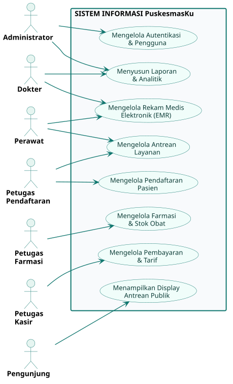
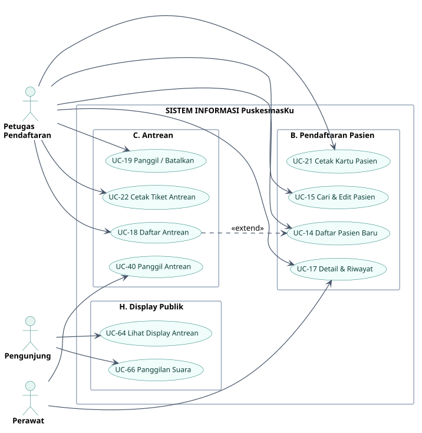
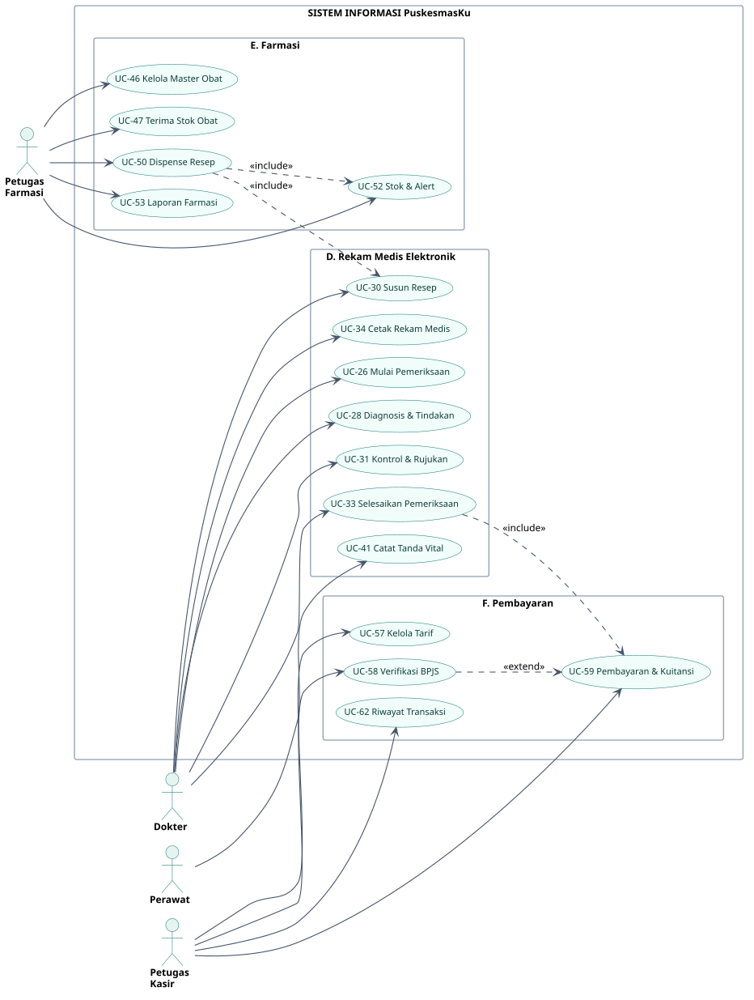
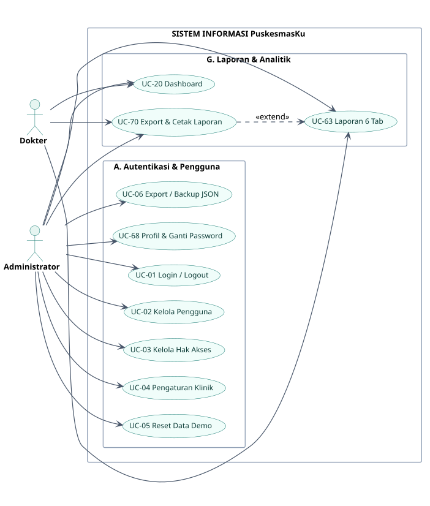

### 4.2 Use Case Diagram — Overview Modul

Diagram overview memberikan gambaran tingkat tinggi: tujuh aktor berinteraksi dengan delapan kelompok fungsi utama sistem. Diagram ini sengaja dibuat pada level modul agar mudah dibaca pada satu halaman; rincian use case per aktor disajikan pada subbab 4.3–4.5 dan Tabel 4.1.

*Gambar 4.1 — Use case diagram overview: 7 aktor dan 8 modul fungsi utama.*

**Cara membaca diagram:**

- **Administrator** memiliki akses ke modul autentikasi/pengguna dan laporan; administrator juga dapat membuka seluruh modul operasional melalui menu, tetapi use case pada diagram overview hanya menampilkan keterkaitan utamanya.
- **Petugas Pendaftaran** mengakses pendaftaran pasien dan antrean.
- **Perawat** mengakses antrean (pemanggilan) dan EMR (asesmen awal/tanda vital).
- **Dokter** mengakses EMR secara penuh serta laporan untuk evaluasi poli.
- **Petugas Farmasi** mengakses farmasi dan stok obat.
- **Petugas Kasir** mengakses pembayaran dan tarif.
- **Pengunjung** dapat melihat display antrean publik tanpa autentikasi.

### 4.3 Use Case Diagram — Front Office dan Antrean

Diagram ini memperinci modul yang dijalankan sebelum pasien masuk ke ruang periksa: pendaftaran pasien, pembuatan antrean, pencetakan tiket, serta display publik.

*Gambar 4.2 — Detail use case front office: Pendaftaran, Perawat, dan Pengunjung.*

**Use case yang ditampilkan (10 UC):**

| Kode | Use Case | Aktor Utama | Keterangan |
|------|----------|-------------|------------|
| UC-14 | Daftar Pasien Baru | Petugas Pendaftaran | Validasi NIK 16 digit dan BPJS 13 digit |
| UC-15 | Cari & Edit Pasien | Petugas Pendaftaran | Pencarian berdasarkan RM/NIK/nama |
| UC-17 | Detail & Riwayat | Petugas Pendaftaran, Perawat | Riwayat kunjungan dan pemeriksaan |
| UC-21 | Cetak Kartu Pasien | Petugas Pendaftaran | Kartu identitas pasien |
| UC-18 | Daftar Antrean | Petugas Pendaftaran | Nomor per poli per hari |
| UC-19 | Panggil / Batalkan | Petugas Pendaftaran | Perubahan status dan alasan batal |
| UC-22 | Cetak Tiket Antrean | Petugas Pendaftaran | Tiket berisi nomor dan poli |
| UC-40 | Panggil Antrean | Perawat | Pemanggilan pasien ke ruang tindakan |
| UC-64 | Lihat Display Antrean | Pengunjung | Tanpa login |
| UC-66 | Panggilan Suara | Pengunjung | Web Speech API, dapat dimatikan |

Relasi **`<<extend>>`** dari UC-18 ke UC-14 menunjukkan bahwa pembuatan antrean dapat memicu pendaftaran pasien baru apabila pasien belum memiliki rekam medis.

### 4.4 Use Case Diagram — Pelayanan Klinis, Farmasi, dan Kasir

Diagram ini memperinci alur inti pelayanan setelah pasien dipanggil: pemeriksaan dokter, penyerahan obat, dan pembayaran.

*Gambar 4.3 — Detail use case klinis: Dokter, Perawat, Farmasi, dan Kasir.*

**Use case yang ditampilkan (16 UC):**

| Kode | Use Case | Aktor Utama | Keterangan |
|------|----------|-------------|------------|
| UC-41 | Catat Tanda Vital | Perawat | TD, nadi, suhu, RR, BB, TB, SpO₂ |
| UC-26 | Mulai Pemeriksaan | Dokter | Dari antrean berstatus dipanggil |
| UC-28 | Diagnosis & Tindakan | Dokter | ICD-10 dan tindakan medis |
| UC-30 | Susun Resep | Dokter | Obat, jumlah, aturan pakai |
| UC-31 | Kontrol & Rujukan | Dokter | Jadwal kontrol atau surat rujukan |
| UC-33 | Selesaikan Pemeriksaan | Dokter | Memicu tagihan otomatis |
| UC-34 | Cetak Rekam Medis | Dokter | Dokumen EMR lengkap |
| UC-46 | Kelola Master Obat | Petugas Farmasi | CRUD obat dan parameter stok |
| UC-47 | Terima Stok Obat | Petugas Farmasi | Mutasi masuk |
| UC-50 | Dispense Resep | Petugas Farmasi | Kurangi stok, catat mutasi |
| UC-52 | Stok & Alert | Petugas Farmasi | Menipis, habis, kedaluwarsa |
| UC-53 | Laporan Farmasi | Petugas Farmasi | Penggunaan obat per periode |
| UC-57 | Kelola Tarif | Petugas Kasir | Konsultasi, tindakan, administrasi |
| UC-58 | Verifikasi BPJS | Petugas Kasir | No. kartu dan No. SEP |
| UC-59 | Pembayaran & Kuitansi | Petugas Kasir | Tunai, QRIS, transfer, debit |
| UC-62 | Riwayat Transaksi | Petugas Kasir | Filter dan ekspor CSV |

**Relasi antar use case:**

- `UC-30 ..> UC-50 : <<include>>` — resep elektronik menjadi prasyarat dispensing.
- `UC-50 ..> UC-52 : <<include>>` — dispensing selalu memeriksa stok dan alert.
- `UC-33 ..> UC-59 : <<include>>` — menyelesaikan pemeriksaan membentuk tagihan.
- `UC-59 ..> UC-58 : <<extend>>` — verifikasi BPJS merupakan perluasan opsional dari pembayaran (hanya untuk pasien BPJS).

### 4.5 Use Case Diagram — Administrasi, Pengguna, dan Laporan

Diagram ini memisahkan fungsi administratif dari alur pelayanan agar hak akses administrator terlihat jelas.

*Gambar 4.4 — Detail use case administrasi: Administrator dan Dokter.*

**Use case yang ditampilkan (10 UC):**

| Kode | Use Case | Aktor Utama | Keterangan |
|------|----------|-------------|------------|
| UC-01 | Login / Logout | Administrator, Dokter | Sesi dan audit |
| UC-02 | Kelola Pengguna | Administrator | CRUD, aktif/nonaktif, reset password |
| UC-03 | Kelola Hak Akses | Administrator | Matriks 6 peran |
| UC-04 | Pengaturan Klinik | Administrator | Identitas dan motto puskesmas |
| UC-05 | Reset Data Demo | Administrator | Mengembalikan data seed |
| UC-06 | Export / Backup JSON | Administrator | Cadangan seluruh data |
| UC-68 | Profil & Ganti Password | Administrator | Akun sendiri |
| UC-20 | Dashboard | Administrator, Dokter | KPI sesuai peran |
| UC-63 | Laporan 6 Tab | Administrator, Dokter | Ringkasan s.d. petugas |
| UC-70 | Export & Cetak Laporan | Administrator, Dokter | CSV dan dokumen cetak |

### 4.6 Use Case Relationships

| Use Case | Include | Extend |
|----------|---------|--------|
| UC-18 (Daftar Antrean) | — | UC-14 (Daftar Pasien Baru) |
| UC-26 (Mulai Pemeriksaan) | UC-18 (Antrean) | — |
| UC-30 (Susun Resep) | UC-26 (Pemeriksaan) | — |
| UC-33 (Selesaikan Pemeriksaan) | UC-26, UC-59 (Buat Tagihan) | — |
| UC-50 (Dispense Resep) | UC-30 (Resep), UC-52 (Cek Stok) | — |
| UC-58 (Verifikasi BPJS) | — | UC-59 (Pembayaran) |
| UC-59 (Terima Pembayaran) | UC-33 (Tagihan) | — |
| UC-70 (Export & Cetak) | — | UC-63 (Laporan 6 Tab) |

> **Catatan:** Tabel 4.1 pada subbab 4.1.2 memuat daftar lengkap **67 use case** (UC-001 s.d. UC-067) beserta aktornya. Diagram 4.1–4.4 menampilkan **36 use case kunci** yang membentuk alur utama; sisanya merupakan variasi operasi CRUD, filter, dan cetak yang mengikuti pola use case induknya.
