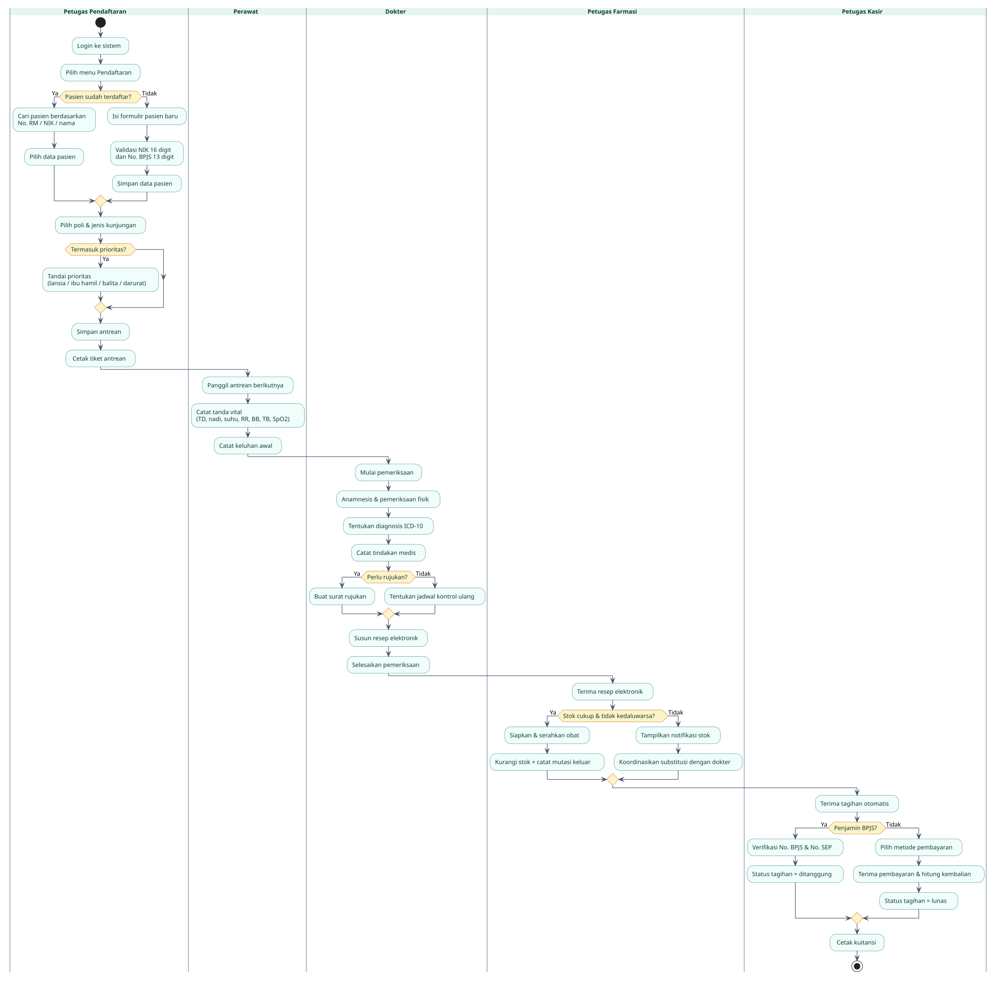
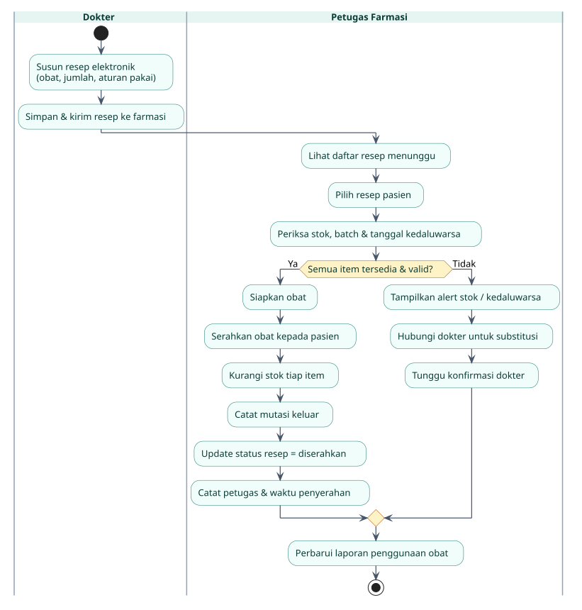
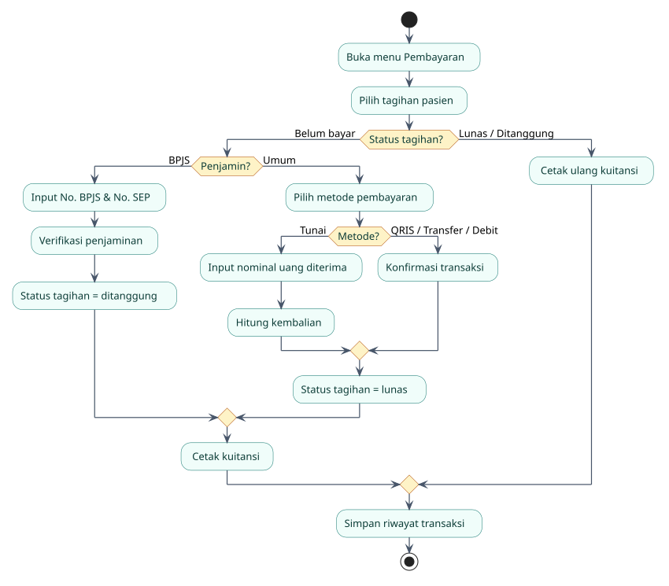
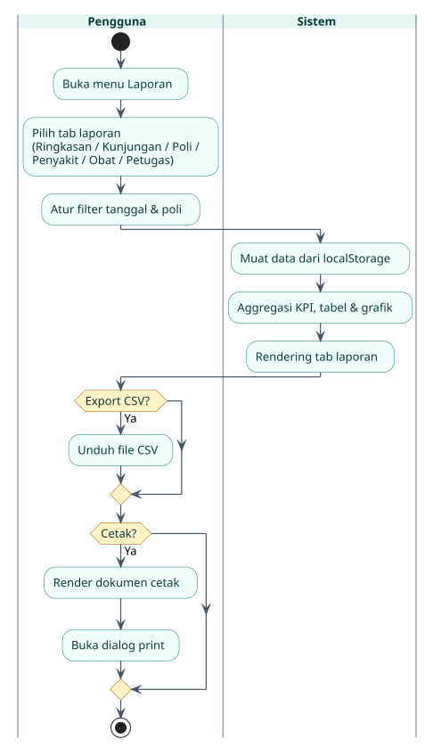

## 5. ACTIVITY DIAGRAM

Activity diagram menggambarkan alur kerja operasional dengan **swimlane** yang menunjukkan pembagian tanggung jawab antarperan. Berbeda dari use case diagram yang menjawab "siapa melakukan apa", activity diagram menjawab "bagaimana urutan langkah dan keputusan dijalankan".

### 5.1 Activity Diagram: Alur Pelayanan Pasien End-to-End

Diagram ini menggambarkan satu siklus pelayanan lengkap, dari pasien datang hingga menerima kuitansi, melalui lima swimlane: Pendaftaran, Perawat, Dokter, Farmasi, dan Kasir.

*Gambar 5.1 — Activity diagram lima swimlane: pendaftaran → triage → pemeriksaan → farmasi → pembayaran.*

**Penjelasan alur:**

1. **Pendaftaran** — petugas login, mencari pasien lama atau membuat pasien baru. Validasi NIK/BPJS dilakukan sebelum data disimpan. Setelah poli dipilih, petugas menentukan apakah pasien termasuk prioritas; jika ya, antrean ditandai agar dipanggil lebih dahulu. Sistem menyimpan antrean dan mencetak tiket.
2. **Perawat** — memanggil antrean berikutnya, mencatat tujuh parameter tanda vital dan keluhan awal. Data ini menjadi asesmen awal bagi dokter.
3. **Dokter** — memulai pemeriksaan, melakukan anamnesis dan pemeriksaan fisik, menegakkan diagnosis ICD-10, mencatat tindakan, lalu memutuskan rujukan atau kontrol ulang. Resep elektronik disusun sebelum pemeriksaan diselesaikan.
4. **Farmasi** — memverifikasi ketersediaan dan kedaluwarsa obat. Jalur normal menyerahkan obat, mengurangi stok, dan mencatat mutasi keluar. Jalur alternatif menampilkan notifikasi stok dan berkoordinasi dengan dokter untuk substitusi.
5. **Kasir** — menerima tagihan otomatis. Pasien BPJS melewati verifikasi No. SEP dan tagihan menjadi ditanggung; pasien umum memilih metode pembayaran, membayar, lalu menerima kuitansi.

**Titik keputusan (decision node):**

| No | Keputusan | Jalur Ya | Jalur Tidak |
|----|-----------|----------|-------------|
| D1 | Pasien sudah terdaftar? | Cari & pilih pasien | Input pasien baru |
| D2 | Termasuk prioritas? | Tandai alasan prioritas | Antrean reguler |
| D3 | Perlu rujukan? | Buat surat rujukan | Jadwalkan kontrol ulang |
| D4 | Stok cukup & tidak kedaluwarsa? | Serahkan obat | Notifikasi & substitusi |
| D5 | Penjamin BPJS? | Verifikasi SEP, ditanggung | Bayar tunai/non-tunai |

**Penanganan pengecualian:** pasien batal di tengah alur dicatat dengan status `batal` dan alasan; stok tidak cukup tidak boleh menghasilkan mutasi negatif; tagihan yang sudah lunas tidak dapat dibayar ulang.

### 5.2 Activity Diagram: Dispensing Resep di Farmasi

Diagram ini memperbesar proses farmasi karena melibatkan validasi stok, kedaluwarsa, dan integritas mutasi.

*Gambar 5.2 — Activity diagram dispensing resep: dokter → petugas farmasi.*

**Aturan penting:**

- Resep hanya muncul di daftar farmasi setelah dokter menyimpan resep elektronik.
- Pemeriksaan mencakup **stok**, **batch**, dan **tanggal kedaluwarsa** untuk setiap item.
- Jika satu item saja tidak valid, seluruh transaksi dispensing dibatalkan (all-or-nothing) agar tidak terjadi penyerahan sebagian yang tidak tercatat.
- Dispensing yang berhasil menulis empat hal secara atomik: stok obat, mutasi keluar, status resep, dan audit trail.
- Substitusi obat harus melalui konfirmasi dokter; petugas farmasi tidak boleh mengubah item resep secara sepihak.

### 5.3 Activity Diagram: Pembayaran dan Verifikasi BPJS

Diagram ini memisahkan jalur pasien BPJS dan pasien umum, serta mencegah pembayaran ganda.

*Gambar 5.3 — Activity diagram pembayaran: verifikasi BPJS, metode bayar, kuitansi.*

**Cabang pembayaran:**

| Metode | Input | Validasi | Output |
|--------|-------|----------|--------|
| Tunai | Nominal uang diterima | Nominal ≥ total; kembalian = nominal − total | Kuitansi tunai |
| QRIS | Konfirmasi transaksi | Nominal tepat | Kuitansi QRIS |
| Transfer Bank | Konfirmasi transaksi | Nominal tepat | Kuitansi transfer |
| Kartu Debit | Konfirmasi transaksi | Nominal tepat | Kuitansi debit |
| BPJS | No. BPJS + No. SEP | 13 digit; SEP terisi | Kuitansi ditanggung |

Status tagihan bergerak dari `belum` → `lunas` atau `belum` → `ditanggung`. Tagihan yang sudah final hanya dapat dicetak ulang; tombol pembayaran dinonaktifkan.

### 5.4 Activity Diagram: Laporan dan Analitik

*Gambar 5.4 — Activity diagram laporan: filter, agregasi, ekspor, dan cetak.*

**Penjelasan:**

1. Pengguna memilih salah satu dari enam tab laporan, lalu mengatur rentang tanggal dan poli.
2. Sistem membaca data dari `localStorage`, melakukan agregasi KPI/tabel/grafik, dan merender tab.
3. Ekspor CSV menggunakan data yang **sudah difilter** dan menambahkan BOM UTF-8 agar karakter Indonesia terbaca di Excel.
4. Cetak menghasilkan dokumen A4 dengan kop puskesmas, periode, tabel, dan area tanda tangan; CSS `@media print` menyembunyikan sidebar/topbar.
5. Deep link seperti `#/laporan/poli` langsung membuka tab yang diminta.

---