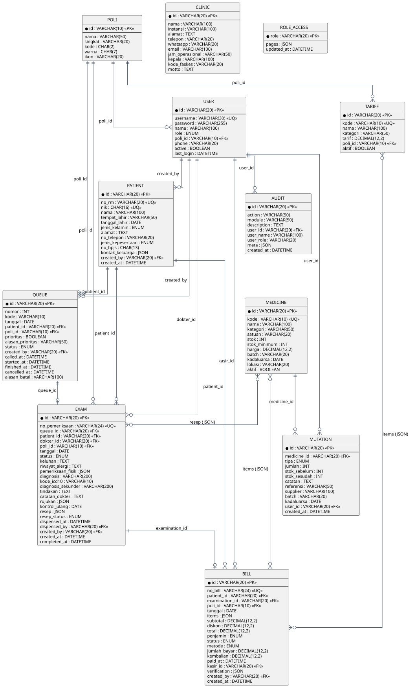

### 6.3 ERD Diagram

ERD digambar menggunakan notasi **Crow's Foot (IE)**. Simbol `||` berarti tepat satu, `o|` berarti nol atau satu, dan `o{` berarti nol atau banyak.

*Gambar 6.1 — ERD 12 entitas utama PuskesmasKu dengan kardinalitas Crow's Foot.*

**Keterangan notasi:**

- `PK` = primary key, `FK` = foreign key, `UQ` = unique constraint.
- `||--o{` = relasi **one-to-many** (satu sisi wajib, sisi lain boleh nol atau banyak).
- `||--o|` = relasi **one-to-one opsional** (satu antrean maksimal menghasilkan satu pemeriksaan; satu pemeriksaan maksimal menghasilkan satu tagihan).
- `}o--o{` = relasi **many-to-many** yang pada implementasi disimpan sebagai array JSON.

### 6.4 Kardinalitas dan Aturan Relasi

| No | Relasi | Kardinalitas | Foreign Key | Aturan Bisnis |
|----|--------|--------------|-------------|---------------|
| R1 | USER → PATIENT | 1 : N | `created_by` | Setiap pasien dicatat oleh tepat satu petugas; satu petugas dapat mendaftarkan banyak pasien. |
| R2 | POLI → USER | 1 : N | `poli_id` | Dokter dapat ditempatkan pada satu poli; poli dapat memiliki banyak dokter. |
| R3 | USER → QUEUE | 1 : N | `created_by` | Antrean dibuat oleh satu petugas pendaftaran. |
| R4 | PATIENT → QUEUE | 1 : N | `patient_id` | Satu pasien dapat memiliki banyak kunjungan/antrean. |
| R5 | POLI → QUEUE | 1 : N | `poli_id` | Nomor antrean unik per poli per tanggal. |
| R6 | QUEUE → EXAM | 1 : 0..1 | `queue_id` | Satu antrean maksimal menghasilkan satu pemeriksaan. |
| R7 | PATIENT → EXAM | 1 : N | `patient_id` | Riwayat pemeriksaan pasien tersimpan kronologis. |
| R8 | USER → EXAM | 1 : N | `dokter_id` | Satu dokter memeriksa banyak pasien; satu pemeriksaan memiliki satu dokter penanggung jawab. |
| R9 | POLI → EXAM | 1 : N | `poli_id` | Pemeriksaan dikelompokkan per poli untuk laporan. |
| R10 | EXAM → BILL | 1 : 0..1 | `examination_id` | Tagihan otomatis dibuat saat pemeriksaan diselesaikan. |
| R11 | PATIENT → BILL | 1 : N | `patient_id` | Satu pasien dapat memiliki banyak tagihan (termasuk tagihan manual). |
| R12 | USER → BILL | 1 : N | `kasir_id` | Kasir yang memproses pembayaran dicatat pada tagihan. |
| R13 | MEDICINE → MUTATION | 1 : N | `medicine_id` | Setiap perubahan stok menghasilkan satu baris mutasi. |
| R14 | USER → MUTATION | 1 : N | `user_id` | Petugas farmasi penanggung jawab mutasi. |
| R15 | USER → AUDIT | 1 : N | `user_id` | Setiap aksi pengguna tercatat pada audit trail. |
| R16 | POLI → TARIFF | 1 : N | `poli_id` | Tarif dapat bersifat global (`poli_id` null) atau spesifik poli. |
| R17 | BILL ↔ MEDICINE | M : N | `items[].medicineId` | Obat yang ditagihkan disimpan pada array item tagihan. |
| R18 | BILL ↔ TARIFF | M : N | `items[].tariffId` | Tarif layanan yang dipakai disimpan pada array item tagihan. |
| R19 | EXAM ↔ MEDICINE | M : N | `resep[].medicineId` | Item resep disimpan sebagai array JSON di dalam pemeriksaan. |

### 6.5 Normalisasi dan Pemetaan JSON

Skema disusun hingga **Third Normal Form (3NF)** untuk entitas utama:

- **1NF** — seluruh atribut bernilai atomik; tidak ada kolom berulang seperti `obat1`, `obat2`. Data berulang dipindahkan ke array JSON atau tabel turunan.
- **2NF** — tidak ada ketergantungan parsial; primary key tunggal (`id`) sehingga seluruh atribut bergantung penuh pada key.
- **3NF** — tidak ada ketergantungan transitif. `nama_poli` tidak disimpan di QUEUE/EXAM, melainkan direferensikan melalui `poli_id`; `nama_obat` dan `harga` disalin ke item tagihan hanya sebagai **snapshot historis** agar nilai transaksi lama tidak berubah ketika master berubah.

**Field JSON dan rencana normalisasi bila dimigrasikan ke RDBMS:**

| Entitas | Field JSON | Isi | Tabel turunan (jika dinormalisasi) |
|---------|------------|-----|-------------------------------------|
| PATIENT | `kontak_keluarga` | nama, hubungan, telepon | `PATIENT_CONTACT` |
| EXAM | `pemeriksaan_fisik` | TD, nadi, suhu, RR, BB, TB, SpO₂ | `VITAL_SIGN` |
| EXAM | `rujukan` | tujuan, alasan, tanggal | `REFERRAL` |
| EXAM | `resep` | medicineId, nama, satuan, harga, jumlah, aturan | `PRESCRIPTION_ITEM` |
| BILL | `items` | tipe, label, qty, harga, tarifId/medicineId | `BILL_ITEM` |
| BILL | `verification` | status, noBPJS, noSEP, verifiedAt/By | `BPJS_VERIFICATION` |
| ROLE_ACCESS | `pages` | daftar ID halaman | `ROLE_PAGE` |
| AUDIT | `meta` | konteks tambahan | `AUDIT_META` |

**Alasan denormalisasi terkontrol:** aplikasi berjalan sepenuhnya di browser dengan penyimpanan `localStorage` yang bersifat *document-oriented*. Menyimpan item transaksi sebagai JSON membuat penulisan bersifat atomik (satu key), mengurangi kompleksitas join, dan tetap menjaga integritas karena seluruh mutasi dilakukan melalui satu lapisan `store` di `js/data.js`. Untuk migrasi ke PostgreSQL/MySQL, tabel turunan di atas dapat dibuat tanpa mengubah kontrak API aplikasi.

### 6.6 Integritas Referensial dan Aturan Bisnis

| Aturan | Implementasi |
|--------|--------------|
| NIK unik 16 digit | Validasi form + pengecekan seluruh pasien sebelum simpan |
| No. RM unik | Format `RM-YYYY-XXXX`, counter per tahun |
| No. BPJS 13 digit | Wajib jika `jenis_kepesertaan = BPJS` |
| Satu antrean → satu pemeriksaan | Pengecekan `queue_id` sebelum membuat EXAM |
| Satu pemeriksaan → satu tagihan | Pengecekan `examination_id` sebelum membuat BILL |
| Stok tidak boleh negatif | Validasi jumlah dispensing terhadap stok saat ini |
| Status antrean valid | Transisi dibatasi (menunggu → dipanggil → dilayani → selesai/batal) |
| Pemeriksaan selesai tidak dapat diubah | Guard pada layer UI dan store |
| Audit tidak dapat dihapus pengguna | Hanya `resetAll()` yang menghapus seluruh data |
| Soft delete pengguna | `active = false`, bukan penghapusan fisik |
| Snapshot harga | Harga obat/tarif disalin ke item tagihan saat transaksi |

---