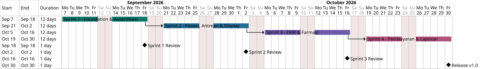

## 7. PERENCANAAN SPRINT 1–4

Pengembangan dilaksanakan dalam **empat sprint**, masing-masing berdurasi **2 minggu (10 hari kerja)**. Total kapasitas yang direncanakan adalah **324 story points**, terdiri dari **290 story points product backlog** dan **34 story points technical enabler** (fondasi aplikasi yang tidak muncul sebagai fitur bisnis tetapi wajib ada).

*Gambar 7.1 — Timeline empat sprint (7 September – 30 Oktober 2026) beserta milestone review dan rilis v1.0.*

### 7.1 Sprint Overview

| Sprint | Tanggal | Fokus Utama | SP Produk | SP Enabler | Total SP | Status |
|--------|---------|-------------|-----------|------------|----------|--------|
| Sprint 1 | 7–18 Sep 2026 | Foundation, Autentikasi & Pengguna | 45 | 34 | **79** | ✅ Selesai |
| Sprint 2 | 21 Sep–2 Okt 2026 | Pasien, Antrean & Display Publik | 81 | 0 | **81** | ✅ Selesai |
| Sprint 3 | 5–16 Okt 2026 | EMR & Farmasi | 82 | 0 | **82** | ✅ Selesai |
| Sprint 4 | 19–30 Okt 2026 | Pembayaran, Tarif & Laporan | 82 | 0 | **82** | ✅ Selesai |
| **Total** | **8 minggu** | **82 item + 3 enabler** | **290** | **34** | **324** | **✅ Selesai** |

> **Mengapa Sprint 1 lebih kecil dari kapasitas?** Sprint pertama mengemban 34 SP pekerjaan fondasi (shell HTML, design system, data layer, routing, UI helpers) yang tidak terlihat sebagai fitur tetapi menjadi prasyarat seluruh modul. Setelah fondasi selesai, velocity stabil di kisaran 81–82 SP.

---

### 7.2 Sprint 1: Foundation & Autentikasi (Minggu 1–2)

**Sprint Goal:** *"Pengguna dapat login, logout, dan administrator dapat mengelola pengguna serta hak akses; fondasi UI dan data layer siap dipakai sprint berikutnya."*

**Sprint Backlog (17 item, 79 SP):**

| ID | Backlog Item | SP | Status |
|----|--------------|----|--------|
| PB-001 | Login dengan username & password | 3 | ✅ |
| PB-002 | Logout dengan audit trail | 2 | ✅ |
| PB-003 | Password reset mandiri via nomor telepon | 5 | ✅ |
| PB-004 | Change password mandiri | 3 | ✅ |
| PB-005 | Update profil pengguna | 2 | ✅ |
| PB-006 | Admin: Create user baru | 5 | ✅ |
| PB-007 | Admin: Update data user | 3 | ✅ |
| PB-008 | Admin: Toggle aktif/nonaktif user | 3 | ✅ |
| PB-009 | Admin: Reset password user | 2 | ✅ |
| PB-010 | Admin: Matriks hak akses per role | 8 | ✅ |
| PB-079 | Pengaturan klinik | 3 | ✅ |
| PB-080 | Reset data demonstrasi | 3 | ✅ |
| PB-081 | Export cadangan data JSON | 2 | ✅ |
| PB-082 | Bump seed version | 1 | ✅ |
| — | Setup HTML shell, CSS variables, routing | 10 | ✅ |
| — | UI helpers (ikon, modal, toast, tabel, grafik) | 12 | ✅ |
| — | Data layer (localStorage, seed 30 hari) | 12 | ✅ |
| **Total** | | **79** | |

**Deliverables:**

- ✅ `index.html` — shell aplikasi, sidebar, topbar, container modal/toast/print, `#displayView`.
- ✅ `css/styles.css` — design token, layout, komponen, responsif, dan gaya cetak.
- ✅ `js/data.js` — store layer, seed data 30 hari, autentikasi, permission, audit.
- ✅ `js/ui.js` — ikon, format tanggal/uang, modal, konfirmasi, toast, grafik, pagination, CSV, print.
- ✅ `js/app.js` — router hash, guard RBAC, login/logout, notifikasi, jam topbar, lifecycle display.
- ✅ `js/users.js` — CRUD pengguna, reset password, matriks akses, pengaturan, profil.
- ✅ Enam akun demo dengan peran berbeda dan satu akun non-aktif untuk pengujian.

**Sprint Review:** Fondasi aplikasi selesai; login, logout, dan RBAC berfungsi. Design system terbentuk dan dapat digunakan ulang. Product Owner menerima increment.

**Sprint Retrospective:**

- ✅ **Baik:** design token konsisten, data layer memiliki satu pintu mutasi sehingga audit mudah.
- ⚠️ **Perbaikan:** dokumentasi kontrak API antar modul belum lengkap.
- 🎯 **Aksi:** tambahkan komentar JSDoc pada `NS.store` dan sepakati format ID entitas sebelum Sprint 2.

---

### 7.3 Sprint 2: Pasien, Antrean & Display Publik (Minggu 3–4)

**Sprint Goal:** *"Petugas dapat mendaftarkan pasien, membuat antrean prioritas, memanggil pasien, dan masyarakat dapat melihat antrean publik tanpa login."*

**Sprint Backlog (24 item, 81 SP):**

| ID | Backlog Item | SP | Status |
|----|--------------|----|--------|
| PB-011 | Daftar pasien baru dengan validasi NIK/BPJS | 5 | ✅ |
| PB-012 | Cari pasien berdasarkan RM, NIK, nama | 3 | ✅ |
| PB-013 | Edit data pasien | 3 | ✅ |
| PB-014 | Detail pasien dengan riwayat kunjungan | 5 | ✅ |
| PB-015 | Cetak kartu pasien | 5 | ✅ |
| PB-016 | Validasi NIK 16 digit unik | 2 | ✅ |
| PB-017 | Validasi BPJS 13 digit | 2 | ✅ |
| PB-018 | Export data pasien ke CSV | 2 | ✅ |
| PB-019 | Daftar antrean baru per poli | 5 | ✅ |
| PB-020 | Priority queue (5 alasan prioritas) | 5 | ✅ |
| PB-021 | Panggil antrean berikutnya | 3 | ✅ |
| PB-022 | Status antrean (5 status) | 3 | ✅ |
| PB-023 | Estimasi waktu tunggu | 3 | ✅ |
| PB-024 | Batal antrean dengan alasan | 2 | ✅ |
| PB-025 | Cetak tiket antrean | 3 | ✅ |
| PB-026 | Filter & pencarian antrean | 2 | ✅ |
| PB-027 | Penyesuaian urutan antrean prioritas | 3 | ✅ |
| PB-028 | Riwayat antrean harian per poli | 3 | ✅ |
| PB-073 | Layar antrean tanpa autentikasi | 8 | ✅ |
| PB-074 | Menampilkan nomor antrean yang dipanggil | 3 | ✅ |
| PB-075 | Menampilkan antrean berikutnya per poli | 3 | ✅ |
| PB-076 | Menampilkan motto puskesmas | 1 | ✅ |
| PB-077 | Tombol fullscreen & kembali | 2 | ✅ |
| PB-078 | Speech announcement panggilan | 5 | ✅ |
| **Total** | | **81** | |

**Deliverables:**

- ✅ `js/patients.js` — direktori pasien, form, validasi, detail, riwayat, cetak kartu.
- ✅ `js/queues.js` — daftar/filter/status, antrean baru, prioritas, tiket, panggilan suara, display publik.
- ✅ Validasi NIK 16 digit unik dan BPJS 13 digit.
- ✅ Antrean per poli dengan reset nomor harian dan lima alasan prioritas.
- ✅ Display publik `#/display` tanpa login, pembaruan berkala, dan cleanup interval saat keluar.
- ✅ Cetak tiket antrean dan kartu pasien.

**Sprint Review:** Modul pasien dan antrean diterima. Product Owner menguji skenario pasien baru + prioritas lansia + panggilan + tampilan publik dalam satu alur.

**Sprint Retrospective:**

- ✅ **Baik:** validasi identitas menutup kasus duplikasi; display publik stabil.
- ⚠️ **Perbaikan:** estimasi waktu tunggu masih menggunakan rata-rata sederhana dan perlu kalibrasi bila data historis bertambah.
- 🎯 **Aksi:** tambahkan data uji pasien BPJS/Umum dan uji tampilan pada TV 16:9 sebelum Sprint 3.

---

### 7.4 Sprint 3: EMR & Farmasi (Minggu 5–6)

**Sprint Goal:** *"Dokter dapat menyelesaikan pemeriksaan lengkap dengan resep, dan petugas farmasi dapat menyerahkan obat dengan pengurangan stok yang tercatat."*

**Sprint Backlog (24 item, 82 SP):**

| ID | Backlog Item | SP | Status |
|----|--------------|----|--------|
| PB-029 | Mulai pemeriksaan dari antrean | 3 | ✅ |
| PB-030 | Catat tanda vital (7 parameter) | 5 | ✅ |
| PB-031 | Input keluhan pasien | 2 | ✅ |
| PB-032 | Diagnosis ICD-10 (14 diagnosis) | 5 | ✅ |
| PB-033 | Catat tindakan fisik | 2 | ✅ |
| PB-034 | Susun resep elektronik | 5 | ✅ |
| PB-035 | Kontrol ulang (14 hari) | 2 | ✅ |
| PB-036 | Rujukan pasien | 3 | ✅ |
| PB-037 | Selesaikan pemeriksaan + buat tagihan | 5 | ✅ |
| PB-038 | Cetak rekam medis lengkap | 5 | ✅ |
| PB-039 | Edit draf pemeriksaan | 3 | ✅ |
| PB-040 | Pemeriksaan selesai tidak dapat diubah | 2 | ✅ |
| PB-041 | Master obat (12 obat seed) | 5 | ✅ |
| PB-042 | Penerimaan stok obat | 5 | ✅ |
| PB-043 | Pengeluaran stok obat | 3 | ✅ |
| PB-044 | Alert stok menipis | 2 | ✅ |
| PB-045 | Alert stok habis | 2 | ✅ |
| PB-046 | Alert obat kedaluwarsa | 2 | ✅ |
| PB-047 | Alert obat akan kedaluwarsa (60 hari) | 2 | ✅ |
| PB-048 | Resep menunggu diserahkan | 3 | ✅ |
| PB-049 | Riwayat mutasi stok | 3 | ✅ |
| PB-050 | Dispense resep (kurangi stok + mutasi) | 5 | ✅ |
| PB-051 | Laporan penggunaan obat | 5 | ✅ |
| PB-052 | Cetak laporan farmasi | 3 | ✅ |
| **Total** | | **82** | |

**Deliverables:**

- ✅ `js/exams.js` — EMR dokter, tanda vital, diagnosis, tindakan, resep, rujukan/kontrol, penyelesaian, cetak.
- ✅ `js/pharmacy.js` — master obat, penerimaan/pengeluaran stok, dispensing, alert, laporan, cetak.
- ✅ 14 diagnosis ICD-10 (12 umum + 2 gigi) dan 12 obat seed dengan tanggal kedaluwarsa.
- ✅ Integrasi EMR → tagihan otomatis dan EMR → resep → farmasi.
- ✅ Empat kategori alert stok dan riwayat mutasi lengkap.

**Sprint Review:** EMR dan farmasi diterima. Skenario pasien hipertensi dengan resep amlodipine diuji dari pemeriksaan sampai obat diserahkan.

**Sprint Retrospective:**

- ✅ **Baik:** integrasi EMR–farmasi–billing berjalan tanpa entri ganda.
- ⚠️ **Perbaikan:** performa pencarian mutasi perlu indeks bila data bertambah besar.
- 🎯 **Aksi:** batasi daftar mutasi dengan pagination dan filter tanggal.

---

### 7.5 Sprint 4: Pembayaran, Tarif & Laporan (Minggu 7–8)

**Sprint Goal:** *"Kasir dapat memverifikasi BPJS, menerima pembayaran empat metode, mencetak kuitansi, dan seluruh peran dapat membaca laporan enam tab yang dapat diekspor."*

**Sprint Backlog (20 item, 82 SP):**

| ID | Backlog Item | SP | Status |
|----|--------------|----|--------|
| PB-053 | Kelola tarif layanan | 5 | ✅ |
| PB-054 | Verifikasi penjaminan BPJS | 5 | ✅ |
| PB-055 | Terima pembayaran (4 metode) | 5 | ✅ |
| PB-056 | Cetak kuitansi digital | 5 | ✅ |
| PB-057 | Tagihan manual | 3 | ✅ |
| PB-058 | Riwayat transaksi lengkap | 3 | ✅ |
| PB-059 | Filter tagihan | 2 | ✅ |
| PB-060 | Export riwayat transaksi CSV | 2 | ✅ |
| PB-061 | Verifikasi BPJS status | 3 | ✅ |
| PB-062 | Set status tagihan | 3 | ✅ |
| PB-063 | 6 tab laporan | 8 | ✅ |
| PB-064 | Filter tanggal, poli, status | 5 | ✅ |
| PB-065 | Ringkasan KPI | 3 | ✅ |
| PB-066 | Laporan kunjungan per poli | 5 | ✅ |
| PB-067 | Laporan penyakit & ICD-10 | 5 | ✅ |
| PB-068 | Laporan obat | 5 | ✅ |
| PB-069 | Laporan kinerja petugas | 5 | ✅ |
| PB-070 | Export laporan CSV | 3 | ✅ |
| PB-071 | Cetak laporan terformat | 5 | ✅ |
| PB-072 | Filter data historis 30 hari | 2 | ✅ |
| **Total** | | **82** | |

**Deliverables:**

- ✅ `js/billing.js` — tarif, tagihan otomatis/manual, verifikasi BPJS, empat metode bayar, kuitansi, riwayat.
- ✅ `js/reports.js` — enam tab laporan, filter tanggal/poli/status, grafik, CSV, cetak.
- ✅ `js/dashboard.js` — dashboard adaptif per peran dengan tren 7 hari.
- ✅ Verifikasi BPJS dengan No. kartu dan No. SEP; status `ditanggung` tanpa pembayaran pasien.
- ✅ Kuitansi dan laporan siap cetak A4.
- ✅ Dokumentasi: `SCRUM.md`, `PANDUAN_PENGGUNAAN.md`, `README.md`, dan makalah ini.

**Sprint Review:** Seluruh modul terintegrasi. Product Owner menjalankan skenario end-to-end: pendaftaran → antrean → EMR → farmasi → pembayaran BPJS → laporan. Increment dinyatakan memenuhi Product Goal v1.0.

**Sprint Retrospective:**

- ✅ **Baik:** integrasi antarmodul konsisten; laporan menggunakan satu sumber agregasi.
- ⚠️ **Perbaikan:** pengujian end-to-end per peran dan finalisasi gaya cetak masih manual.
- 🎯 **Aksi:** uji browser lintas peran, uji responsif 360/768/1280 px, dan audit akses langsung via URL.

---

### 7.6 Velocity dan Burndown Product Backlog

| Akhir Sprint | Item Selesai | SP Produk Selesai | SP Produk Tersisa | SP Enabler | Total SP Sprint | Velocity |
|--------------|--------------|-------------------|-------------------|------------|-----------------|----------|
| Sprint 1 | 14 | 45 | 245 | 34 | 79 | 79 |
| Sprint 2 | 24 | 81 | 164 | 0 | 81 | 81 |
| Sprint 3 | 24 | 82 | 82 | 0 | 82 | 82 |
| Sprint 4 | 20 | 82 | 0 | 0 | 82 | 82 |
| **Total** | **82** | **290** | **0** | **34** | **324** | **rata-rata 81** |

**Interpretasi:**

- Product backlog terbakar dari 290 SP menjadi 0 SP dalam empat sprint.
- Velocity produk stabil pada 81–82 SP setelah Sprint 1, sehingga kapasitas sprint berikutnya dapat diprediksi.
- Tidak ada sprint yang gagal memenuhi Sprint Goal; seluruh 82 item memenuhi Definition of Done.
- Sisa 0 SP menandakan cakupan v1.0 selesai, bukan berarti tidak ada pengembangan lanjutan (lihat subbab 8.5).

### 7.7 Scrum Ceremonies dan Artefak

| Ceremony | Frekuensi | Durasi | Output |
|----------|-----------|--------|--------|
| Sprint Planning | Awal sprint | 2 jam | Sprint Goal + Sprint Backlog |
| Daily Scrum | Harian | 15 menit | Hambatan dan rencana 24 jam |
| Sprint Review | Akhir sprint | 1 jam | Demo increment + umpan balik Product Owner |
| Sprint Retrospective | Akhir sprint | 45 menit | Action item perbaikan proses |
| Backlog Refinement | Mingguan | 1 jam | Estimasi dan pemecahan item besar |

**Artefak:** Product Backlog (82 item), Sprint Backlog (per sprint), Increment (aplikasi yang dapat dijalankan), Definition of Ready, dan Definition of Done.

### 7.8 Manajemen Risiko

| Risiko | Probabilitas | Dampak | Mitigasi |
|--------|--------------|--------|----------|
| Scope creep dari permintaan fitur baru | Tinggi | Tinggi | MoSCoW, change control, future backlog |
| Kuota `localStorage` habis | Sedang | Sedang | Seed dibatasi 30 hari; export JSON; reset data |
| Perbedaan tampilan cetak antar browser | Tinggi | Sedang | CSS `@media print` terpusat; uji PDF |
| Salah konfigurasi hak akses | Sedang | Tinggi | Menu pengguna terkunci untuk admin; audit; reset default |
| Inkonsistensi stok akibat mutasi ganda | Rendah | Tinggi | Mutasi atomik di store; validasi stok sebelum dispensing |
| Kehilangan data demo | Sedang | Tinggi | Export/backup JSON; reset ke seed |
| Kinerja menurun pada data besar | Sedang | Sedang | Pagination, filter, agregasi sekali jalan |
| Perangkat lama tidak mendukung `color-mix()`/`:has()` | Sedang | Rendah | Gunakan browser modern; sediakan fallback warna dasar |

### 7.9 Traceability Matrix

| Modul | Backlog | Use Case | File Utama | Sprint |
|-------|---------|----------|------------|--------|
| A. Autentikasi & Pengguna | PB-001–010, 079–082 | UC-001–006, UC-068 | `app.js`, `users.js` | 1 |
| B. Pendaftaran Pasien | PB-011–018 | UC-013–022 | `patients.js` | 2 |
| C. Antrean | PB-019–028 | UC-018–022, UC-040 | `queues.js` | 2 |
| D. Rekam Medis Elektronik | PB-029–040 | UC-023–036 | `exams.js` | 3 |
| E. Farmasi & Obat | PB-041–052 | UC-044–054 | `pharmacy.js` | 3 |
| F. Pembayaran & Tarif | PB-053–062 | UC-055–063 | `billing.js` | 4 |
| G. Laporan & Analitik | PB-063–072 | UC-063–072 | `reports.js`, `dashboard.js` | 4 |
| H. Display Publik & Pengaturan | PB-073–082 | UC-064–067 | `queues.js`, `users.js` | 1–2 |

---